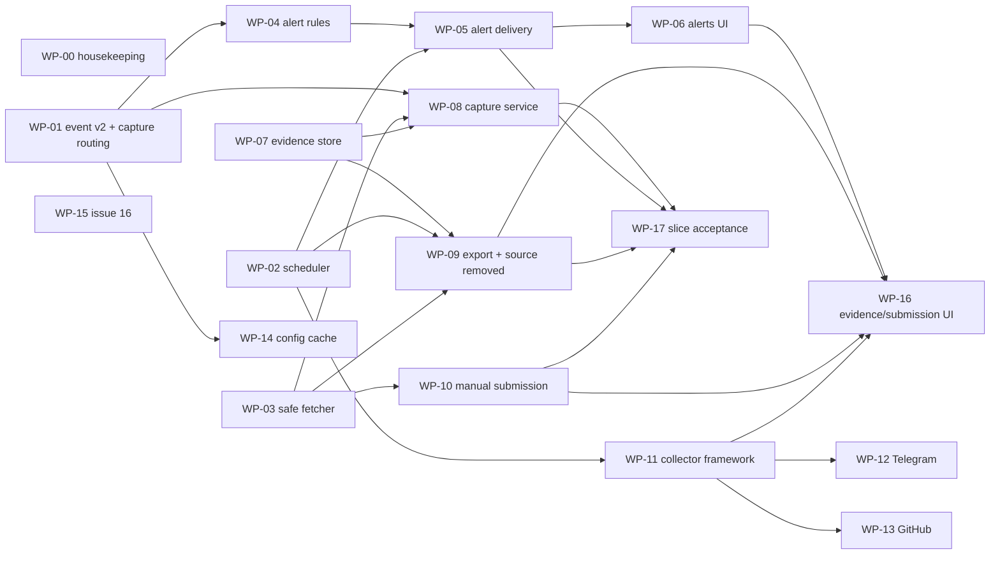

# Orchestration Plan: Phase 1 Closure to MVP

Status: proposed, not started. Written 2026-10-12 from a fresh clone of `master`
at `9250946` ("Mark Phase 1 complete in the docs").
Audience: an agent orchestrator that hands work packages (WPs) to coding agents,
and the human owner who approves decisions, credentials, and merges.
Authority: `docs/tasks.md` stays the authoritative task list and
`docs/design.md` / `docs/requirements.md` stay authoritative for behaviour. This
plan sequences the remaining work, fills the gaps the design leaves open, and
gives each agent a self-contained brief. Where this plan and the design
disagree, the design wins unless the decision register (section 4) records an
accepted deviation.

---

## 0. How to use this document

1. Read sections 1-5 once. They hold the verified starting state, the rules
   every agent follows, and the decisions every WP depends on.
2. Before dispatching anything, get the human owner to answer the decisions
   marked **CONFIRM** in section 4 and the gates in section 6. A WP whose
   decisions or gates are open is blocked; do not dispatch it.
3. Dispatch WPs wave by wave (section 5.3). Inside a wave, WPs in different
   lanes run in parallel; WPs in the same lane run one after another.
4. Give each agent: this file's sections 2-4, its own WP section, the files the
   WP lists under "Read first", and the brief template in Appendix A.
5. Every WP ends in a pull request that passes its acceptance commands and an
   independent review (section 3.7). Only then does the orchestrator merge it,
   or hand it to the human, per the merge policy in section 3.4.
6. After each merge, update the WP status table (section 7) and tick the
   matching box in `docs/tasks.md` only when that task's "Done when" line is met.

Terminology: **M1/M2/M3** are milestones in this plan. **"Phase 1"** in
`docs/phase1-plan.md` meant the evaluation and durability work (now done); in
`docs/tasks.md` "Phase 1" means the vertical slice (tasks 5-12). This plan uses
task numbers to avoid that ambiguity.

---

## 1. Verified starting state (audit of 2026-10-12)

`docs/tasks.md` ticks only 3.1, 4.3, and 9.4, but most of tasks 1-9 are built.
The table below is from reading the code, the migrations, the tests, and the
commit history; it is what agents should assume.

### 1.1 Task status

| Task | Real status | Evidence | Gap to close |
|---|---|---|---|
| 1 Skeleton | Done | `pyproject.toml`, `Dockerfile` (4 targets), `docker-compose.yml`, CI/CD workflows | none |
| 2.1 Schema | Done | `migrations/versions/0002_initial_schema.py` incl. `trg_incidents_merged_into`; `tests/test_aegis_schema.py` | none |
| 2.2 Item schema v1 | Done | `aegis/common/schemas.py`, `aegis/common/item_v1.schema.json`, `tests/fixtures/items/` | none |
| 2.3 Object storage | Done | `aegis/common/storage.py`, `deploy/minio/*.json`, `tests/test_aegis_storage_minio.py` | none |
| 3.1 Topology + workers | Done (ticked) | `aegis/common/messaging.py`, `topology.py`, `dlq.py`, durability suite | none |
| 3.2 Outbox | Done | `aegis/common/outbox.py`, `aegis/pipeline/outbox_publisher.py`, outbox tests | none (WP-01 extends routes) |
| 4.1 Replay + generator | Done | `aegis/collectors/replay.py`, `synthetic.py` | none |
| 4.2 Eval harness | Done | `aegis/eval/*`, `make eval`, `make eval-gate` | tasks.md still names `data/golden/`; real path is `data/private/golden/` |
| 4.3 Golden set | Done (ticked) | Aegis-data `094d2a2`, `bb791bf` | issue #16 (WP-15) |
| 5.1 VIP CRUD | Mostly done | `aegis/api/services/vips.py` bumps `config_version`, audits | `config.changed` is **never emitted**; no 60 s config cache (WP-14) |
| 5.2 Reference media | Done for hashes | `aegis/common/images.py`, VIP router | embeddings arrive with 14.2 |
| 5.3 Fingerprints | Done | `aegis/common/fingerprints.py`, `aegis/api/services/fingerprints.py` | none |
| 6.1 Normalizer | Done | `aegis/pipeline/normalizer.py` (versions, snapshots, reach re-score flag, priority for `manual`) | none |
| 6.2 Mentions + media fork | Text part done | `aegis/detectors/mentions.py` | media fork is Phase 2 (WP-21) |
| 7.1 Stage 1 | Done | `aegis/detectors/lexicons.py`, `text.py`, `toxicity.py` | none |
| 7.2 Stage 2 | Done with identity calibrator | `aegis/detectors/intent.py`, `aegis/common/llm_budget.py` | calibrator fit deferred (WP-41); issue #16 (WP-15) |
| 8.1 Scoring | Done | `aegis/pipeline/scoring.py`, `migrations/versions/0003_seed_scoring_config.py` | media/campaign/attachment triggers arrive with later tasks |
| 8.2 Item incidents | Done except capture enqueue | `aegis/pipeline/incidents.py` computes `capture_required` | **nothing enqueues `evidence.capture`** (WP-01) |
| 9.1 API foundations | Done | `aegis/api/security.py`, `dependencies.py`, `middleware.py` | none |
| 9.2 Incident endpoints | Done except notification | `aegis/api/services/incidents.py` | assignment does not notify the assignee (WP-05) |
| 9.3 WebSocket | Done | `aegis/api/websocket.py` | none |
| 9.4 Dashboard | Done (ticked) | `frontend/` | evidence panel lists artifacts but there is nothing to list yet |
| 9.5 Users + admin CLI | Done | `aegis/api/routers/users.py`, `aegis/api/admin.py` | none |
| 10.1-10.3 Evidence | **Not started** | `aegis/evidence/capture.py` is a placeholder; `retention.py` exists | WP-07, WP-08, WP-09 |
| 11.1-11.2 Alerting | **Not started** | `aegis/alerting/__init__.py` is empty; queue `events.incidents.alerting` is already declared | WP-04, WP-05 |
| 12.1-12.3 Sources | **Not started** | only replay and synthetic exist | WP-10 to WP-13 |
| 13-21 | Not started, except: FP labels are written on status change; CI already runs `make eval` / `make eval-gate` when the private checkout is present | | M2, M3 |

### 1.2 Other facts agents must know

- Tests: 269 test functions in 37 test modules. Without Postgres/RabbitMQ/MinIO the
  DB and broker tests skip (`AEGIS_TEST_DATABASE_URL`, `AEGIS_TEST_RABBITMQ_URL`).
  A sandbox with no Docker can only run the pure-Python subset; anything that
  touches schema, queues, or storage must be verified on a machine with the
  Compose stack (the owner's WSL2 box, or CI).
- No Prometheus metrics are exported yet. No `/sources/health` endpoint exists.
- There is no periodic job runner. Escalation, digests, source-removed checks,
  staleness checks, retention, the campaign detector, and the impersonation
  sweeper all need one (WP-02).
- There is no SSRF-safe HTTP client. Manual submission, media download, and
  source-removed checks all need one (WP-03).
- Retry and DLQ queues are declared only for the five work queues. A
  `QueueConsumer` on any other queue (such as `events.incidents.alerting`)
  would publish failures to queues that do not exist, and RabbitMQ drops
  unroutable messages. WP-04 fixes this for alerting.
- `config.recompute` is declared and bound to `events.config` but has no
  consumer; once WP-14 starts emitting `config.changed`, messages would pile up
  there, so WP-14 adds a temporary consumer.
- `QueueConsumer` takes no prefetch argument; capture and media consumers need
  `channel.set_qos(prefetch_count=1)` set before `start()`.
- `upsert_item_incident` publishes `incident.created` / `incident.updated` with
  `incident_id`, `item_id`, `severity`, `risk_score`, `vip_ids`. The API's
  `_publish_update` adds `status` but omits `item_id`. Neither carries the
  previous severity, threat types, account, or campaign, which alerting needs.
- `load_vip_configs` reads VIPs from Postgres on every item and rebuilds the
  Aho-Corasick automaton each time. Correct (pause is immediate) but slow; it
  must be cached before load tests (WP-14).
- Dev machine: WSL2 Ubuntu 22.04, RTX 3050 4 GB, 15.4 GB RAM, Ollama in the
  distro, model `aegis-intent` from `deploy/ollama/Modelfile.aegis-intent`.
  Media models do not fit beside a loaded LLM: run the media worker on CPU in
  dev or unload the LLM first.
- Data rule: no real personal data or real threat text in this repository.
  Golden sets, caches, and text-bearing reports live in the private
  `Aegis-data` repository (`make data` clones it to `data/private/`).

---

## 2. Milestones and exit criteria

### M1 - Vertical slice closure (tasks 10, 11, 12, plus debt)

The slice the design promises: a replayed or submitted item flows through
detection to a live incident, the incident is captured as tamper-evident
evidence, and a Slack or email alert goes out.

Exit criteria (all must hold; WP-17 proves them):

1. Replaying the synthetic dataset produces the expected incidents (existing
   behaviour), and every incident at or above medium gets a manifest-chained
   evidence set in MinIO under governance retention.
2. A critical incident produces an email and a Slack alert whose dispatch time
   is within 2 minutes of the item's `collected_at` at low load, with an
   Acknowledge action that stops escalation.
3. An exported evidence ZIP verifies with `python -m aegis.evidence.verify`,
   and verification fails if any artifact or any earlier manifest is altered.
4. An analyst can submit a URL in the dashboard and see it become an item and,
   when it scores, an incident.
5. The Telegram and GitHub collectors pass their tests against fakes, report
   into `source_health`, and can be switched on once the owner supplies
   credentials and clears the data-protection gate (G-06).
6. Issue #16 is fixed and the gate set is restored toward 1,713 items, or the
   owner has accepted a documented reason why not.
7. `docs/tasks.md` reflects reality.

### M2 - Broaden detection (tasks 13-18, plus the deferred calibrator)

Exit: impersonation, media, leak, and campaign detectors meet their golden-set
targets in `make eval`; account incidents work end to end; search and saved
searches work; labels and suppressions close the feedback loop; the eval gate
covers every detector.

### M3 - Hardening and MVP release (tasks 19-21)

Exit: retention and offboarding jobs run; encryption in transit and at rest;
`docs/data-protection.md` approved; metrics, dashboards, and operational alerts
live; load tests meet the latency and drain targets; a timed restore meets the
agreed RPO/RTO; the security review's findings are fixed. That is the MVP
release defined in `docs/requirements.md`.

---

## 3. Rules for every agent

### 3.1 Read before writing

Every agent reads `AGENTS.md`, its WP section here, the design sections its WP
cites, and the neighbouring code it will extend. Follow existing patterns in
neighbouring files: session handling via `aegis.common.db.session_scope`,
consumers via `QueueConsumer`, publishing via `Producer` or the outbox,
settings via `aegis.common.config.get_settings`, logging via
`aegis.common.logging.get_logger`.

### 3.2 Code conventions (from `AGENTS.md` and `pyproject.toml`)

- Python 3.12, `uv`. ruff line length 120, rules `E,F,W,I,UP,B,SIM,C4,PT`.
  `mypy --strict` on `aegis/` must pass.
- No comments unless asked; docstrings in the existing style are fine.
- Tests live in `tests/test_aegis_<area>.py`. DB tests use the existing
  `DB_REQUIRED` skip pattern and fixtures in `tests/conftest.py`; broker tests
  use `AEGIS_TEST_RABBITMQ_URL`; long-running stack tests are gated by
  `AEGIS_INTEGRATION=1`.
- New settings go in `aegis/common/config.py` **and** `.env.example`, with safe
  development defaults. Secrets use `SecretStr`. New secret defaults that must
  be changed in production go in `DEFAULT_SECRET_VALUES`.
- New heavy dependencies go in the matching dependency group, never in core.
  Run `uv lock` and commit `uv.lock` with the change.
- New entrypoints go in `[project.scripts]` and get a Compose service.
- No real personal data, real threat text, real tokens, or valid-format real
  credentials in fixtures. Use fictional names from the existing roster and
  invalid phone formats, as the gate-set work did.

### 3.3 Branches, commits, and PRs

- One branch per WP: `wp/<id>-<slug>`, e.g. `wp/04-alert-rules`.
- Commit messages follow the existing style: imperative, sentence case, no
  prefix ("Add the alert rules engine and grouping").
- PR title = the WP title. PR body uses Appendix B.
- Keep each PR to one WP. If a WP turns out too large, split it with the
  orchestrator's approval and update section 7.

### 3.4 Commit and merge policy - accepted (G-01, 2026-10-13)

Accepted by the owner as proposed; WP-00 wrote it into `AGENTS.md`, replacing
the old rule "Do not commit unless the user explicitly asks." Delegated agents
cannot work under that rule.

- Agents dispatched by the orchestrator may commit to their WP branch, push it,
  and open a PR.
- Agents never push to `master`, never force-push a branch someone else owns,
  never rewrite history, and never merge their own PR.
- Merges to `master` need a green CI run, an independent review (3.7), and the
  owner's approval for any WP tagged `[HUMAN]` or touching auth, evidence
  integrity, masking, or migrations. Other WPs may be merged by the
  orchestrator.

### 3.5 Shared files and conflict control

Some files are touched by many WPs. To keep merges clean:

| Shared file or area | Rule |
|---|---|
| `migrations/versions/` | One migration per WP at most. Write it with `down_revision` set to the head at branch time. Before merge, rebase and reset `down_revision` to the current head; the file number (`0005_…`, `0006_…`) is assigned at merge time in merge order. WP-00 adds a test that fails if Alembic has more than one head. |
| `aegis/common/models/*.py` | Add columns and tables only in the WP that owns the matching migration. Never edit an existing column's meaning. |
| `aegis/common/models/enums.py` | Append members only. Enum values are also DB check constraints, so a new value needs a migration that drops and recreates the constraint. |
| `aegis/common/config.py`, `.env.example` | Append-only blocks per WP, grouped under a comment-free blank-line section. Rebase before merge. |
| `aegis/common/outbox.py`, `topology.py` | Owned by WP-01 in M1. Later WPs append constants only. |
| `docker-compose.yml`, `Makefile`, `pyproject.toml`, `uv.lock` | Append services/targets/deps; re-run `uv lock` after rebase. |
| `frontend/src/App.tsx`, `frontend/src/api/types.ts`, `components/AppShell.tsx` | Frontend WPs run in one lane, one at a time (section 5.2). |
| `docs/tasks.md` | Only WP-00 restructures it. Other WPs tick their own boxes in their PR. |

### 3.6 Definition of done (every WP)

1. Code, tests, migration (if any), settings, `.env.example`, Compose service
   (if any), `Makefile` target (if any), and README/AGENTS updates are in the PR.
2. `make lint` passes (ruff check, ruff format check, mypy strict).
3. `make test` passes with Postgres, RabbitMQ, and MinIO available
   (`AEGIS_TEST_DATABASE_URL`, `AEGIS_TEST_RABBITMQ_URL` set). A run that only
   skipped the relevant tests does not count.
4. If the WP adds a migration: `uv run alembic upgrade head`, then
   `uv run alembic downgrade -1`, then `uv run alembic upgrade head` all
   succeed on an empty database, and the single-head test passes.
5. If the WP touches queue code: `make integration` passes.
6. If the WP touches detectors, lexicons, scoring config, or prompts:
   `make eval` and `make eval-gate` pass on the private set, or the PR explains
   the regression and the owner accepts a new baseline.
7. If the WP touches the frontend: `make frontend-test` and
   `make frontend-build` pass; if it changes the triage flow, `make e2e` passes.
8. The WP's own acceptance checks (listed per WP) pass and are pasted into the
   PR body with their output.
9. The matching `docs/tasks.md` box is ticked only if that task's "Done when"
   line is fully met; otherwise the PR says what remains.

### 3.7 Independent review

Every PR is reviewed by a separate agent (or the owner) that did not write it,
using `engineering:code-review`-style checks: correctness against the cited
design section, VIP-scope and role enforcement on every new endpoint, no
unmasked sensitive values in responses/logs/alerts, idempotency of every
consumer, transaction boundaries (outbox row in the same transaction as the
change), and test coverage of each acceptance check. WPs that touch evidence
integrity, auth, masking, or SSRF get a second, security-focused review.

### 3.8 When an agent must stop and ask

An agent stops, writes what it found, and returns to the orchestrator when:

- the design is silent or contradictory on something that changes behaviour
  and section 4 does not decide it;
- a fix needs a schema change outside its WP's migration;
- a test that passed before its change now fails for a reason outside its WP;
- it would need real credentials, real data, network access beyond the
  package registries, or a GPU it does not have;
- the eval gate regresses.

It does not invent a policy, weaken a test, or skip a check to get green.

### 3.9 Environment tags

Each WP lists the environment it needs:

| Tag | Meaning |
|---|---|
| `[PY]` | Pure Python; runs in any sandbox with `uv sync` |
| `[STACK]` | Needs Postgres, RabbitMQ, and MinIO (Compose stack or CI services) |
| `[BROWSER]` | Needs Playwright Chromium (`uv sync --group capture`, `playwright install chromium`) |
| `[GPU]` | Needs the owner's RTX 3050 + Ollama in WSL2 |
| `[PRIV]` | Needs the private `Aegis-data` checkout |
| `[EXT]` | Needs real third-party credentials (Slack, SMTP, Telegram, GitHub) |
| `[HUMAN]` | Needs an owner decision, review, or manual step before or during the WP |

---

## 4. Decision register

Decisions every WP relies on. **CONFIRM** items need the owner's answer before
the dependent WPs are dispatched; the proposed default is what agents build if
the owner says "go with the default".

| ID | Topic | Proposed decision | Status |
|---|---|---|---|
| D-01 | How capture jobs are enqueued | Through the transactional outbox, not a direct publish from the worker. New outbox event type `evidence.capture_requested`, routed to the default exchange with routing key `evidence.capture`. The incident write and the capture request commit or roll back together, which matches design principle "Lost events: transactional outbox". | Default |
| D-02 | Incident event payload | Version 2 payload (WP-01) with `schema: 2`, `incident_id`, `subject_type`, `item_id`, `account_id`, `campaign_id`, `vip_ids`, `severity`, `previous_severity`, `risk_score`, `status`, `threat_types`, `change` (one of `created`, `rescored`, `status`, `assigned`, `note`, `merged`, `capture`, `source_removed`), `actor_id`, and for `assigned` the `assignee_id`. No item text and no sensitive values in the payload. Consumers must accept v1 payloads (no `schema` key) for one release. | Default |
| D-03 | Periodic jobs | One `aegis-scheduler` process (WP-02). Each job takes a Postgres advisory lock for its run so two scheduler instances never run the same job at once; every job is idempotent. | Default |
| D-04 | Where alerting runs | New entrypoint `aegis-alerting` in the `analysis` image (the design puts alerting in the general worker image). It consumes `events.incidents.alerting` and runs the delivery loop. Escalation and digests run as scheduler jobs. | Default |
| D-05 | Alert recipients | `alert_rules` gains `name`, `enabled`, `recipients` (JSON list of `{channel, address}`; Slack address is a channel ID or user ID), `digest_severities`, `digest_interval` (`hourly`/`daily`), `timezone`. A user-scope rule's default recipient is that user's email and, if set, `users.slack_user_id`. A VIP-scope rule lists its recipients explicitly. | Confirmed (G-02, 2026-10-13, proposed defaults) |
| D-06 | Alert grouping and throttling | Group key = (vip_id, campaign_id or the author `account_id`, threat_type) in a 30-minute window starting at the group's first alert. First match opens an alert and sends it immediately. Later matches in the window append to `alerts.incident_ids` and send an "update" at most once per 5 minutes per alert (Slack thread reply, email with "Update:" subject), except that any escalation to critical sends at once. An `incident.updated` event alerts only if severity crosses a rule's `min_severity` upward; status, note, and assignment changes never produce threat alerts. | Confirmed (G-02, 2026-10-13, proposed defaults) |
| D-07 | Masking in alerts before task 15.3 | Alerts never include item text for incidents with a `leak` threat type. Other snippets pass through a conservative masker (`aegis/common/masking.py`, WP-04) that masks phone numbers, emails, Aadhaar/PAN-format strings, and long digit runs. WP-30 (15.3) later swaps this for the real masking service. | Default |
| D-08 | Capture egress proxy | A Squid container (`egress-proxy`) with deny ACLs on destination IPs for 0.0.0.0/8, 10/8, 100.64/10, 127/8, 169.254/16, 172.16/12, 192.168/16, 224/4, 240/4, ::1, fc00::/7, fe80::/10, and the metadata addresses. The capture container sits on an `internal: true` Compose network whose only route out is the proxy. Squid resolves DNS itself, so a rebinding hostname is checked at connect time. | Default |
| D-09 | Manual submission when no extractor works | The analyst must enter the text; the item is created from that text with `raw` holding the URL, fetch status, and the analyst's note. The screenshot is taken by the normal evidence path once the item becomes an incident. This differs from tasks.md 12.1 ("fall back to screenshot capture plus analyst-entered text"): a pre-incident screenshot would need evidence without an incident. Alternative: add a `submission_preview` capture kind stored in the media bucket. | Confirmed (G-02, 2026-10-13, proposed defaults) |
| D-10 | Collector configuration | Targets (Telegram channels, extra GitHub queries) live in a new `collector_targets` table managed with `aegis-admin targets {add,list,disable}`. Cursors stay in `connector_cursors` (one row per source; per-target state inside the JSON). Credentials stay in settings. | Default |
| D-11 | VIP official domains | New table `vip_domains (vip_id, domain)` with API endpoints on the VIP router, added in the sources migration (WP-11). Used by GitHub queries now and by the solicitation detector (non-official domain links) in WP-25. | Default |
| D-12 | Migration numbering | Assigned at merge time (section 3.5). A test asserts a single Alembic head. | Default |
| D-13 | Dev mail and Slack | Mailpit as a Compose service under profile `alerting` for local email; Slack mocked with `respx` in tests. A real Slack app is optional for M1 and needs G-03. | Default |
| D-14 | Time zone | Quiet hours and digest schedules are evaluated in each rule's `timezone`, default `Asia/Kolkata`. Stored timestamps stay UTC. | Default |
| D-15 | Live collection before data protection | Collectors may be built and tested against fakes at any time. Running them against live Telegram/GitHub, which stores real third-party content in the database, waits for gate G-06. | Confirmed (G-02, 2026-10-13, proposed defaults) |
| D-16 | Retry policy for captures | Use the queue retry and DLQ mechanism (`RetryPolicy`, max 5 attempts, exponential backoff) rather than in-process retry loops, and record the final failure when the last attempt fails. | Default |

---

## 5. Work breakdown, dependencies, and schedule

### 5.1 Work package index

Sizes: **S** is about half a day of agent work and one small PR; **M** is one to
two days and a PR of a few hundred lines; **L** is three days or more and
should be considered for splitting.

| WP | Title | Tasks | Milestone | Lane | Env | Size | Depends on |
|---|---|---|---|---|---|---|---|
| WP-00 | Housekeeping and guardrails | docs | M1 | PLAT | `[PY][HUMAN]` | S | - |
| WP-01 | Incident event contract v2 and capture routing | 8.2, 3.2 | M1 | PLAT | `[STACK]` | M | - |
| WP-02 | Periodic job scheduler | infra | M1 | PLAT | `[STACK]` | M | - |
| WP-03 | SSRF-safe fetcher and SSRF test suite | 12.1, 14.1 | M1 | SRC | `[PY]` | M | - |
| WP-04 | Alerting schema, rules engine, grouping | 11.1 | M1 | ALERT | `[STACK]` | L | WP-01 |
| WP-05 | Alert delivery, acknowledge, escalation, digests, assignment notices | 11.2, 9.2 | M1 | ALERT | `[STACK]` (`[EXT]` optional) | L | WP-04, WP-02 |
| WP-06 | Dashboard: alerts and alert rules | 11.x UI | M1 | FE | `[PY]` + Node | M | WP-05 |
| WP-07 | Evidence store, manifest chain, custody | 10.2 core | M1 | EVID | `[STACK]` | M | - |
| WP-08 | Capture service and egress proxy | 10.1 | M1 | EVID | `[STACK][BROWSER]` | L | WP-01, WP-03, WP-07 |
| WP-09 | Evidence API, export, verify CLI, source-removed checks | 10.2, 10.3 | M1 | EVID | `[STACK]` | M | WP-07, WP-02, WP-03 |
| WP-10 | Manual URL submission backend | 12.1 | M1 | SRC | `[STACK]` | L | WP-03 |
| WP-11 | Collector framework, source health, targets, VIP domains | 12.2/12.3 base, 2.7 | M1 | SRC | `[STACK]` | M | WP-02 |
| WP-12 | Telegram collector | 12.2 | M1 | SRC | `[STACK][EXT][HUMAN]` | M | WP-11 |
| WP-13 | GitHub code search collector | 12.3 | M1 | SRC | `[STACK][EXT][HUMAN]` | M | WP-11 |
| WP-14 | VIP config cache and `config.changed` events | 5.1 | M1 | PLAT | `[STACK]` | S | WP-01 |
| WP-15 | Issue #16 fix and gate-set restoration | 4.3, 7.2 | M1 | ML | `[GPU][PRIV][HUMAN]` | M | - |
| WP-16 | Dashboard: evidence, submissions, source health | 10, 11.5, 12.1 UI | M1 | FE | Node | M | WP-06, WP-09, WP-10, WP-11 |
| WP-17 | Slice acceptance test and demo runbook | M1 exit | M1 | QA | `[STACK][BROWSER]` | M | WP-05, WP-08, WP-09, WP-10 |
| WP-20 | Media worker: safe download, ClamAV, storage | 14.1 | M2 | MEDIA | `[STACK]` | M | WP-03 |
| WP-21 | Media fork, fingerprints, reference matching, repurposed media | 6.2, 14.2, 5.2 | M2 | MEDIA | `[STACK]` | L | WP-20 |
| WP-22 | OCR and video keyframes | 14.3 | M2 | MEDIA | `[STACK]` | M | WP-21 |
| WP-23 | Reverse image search provider | 14.4 | M2 | MEDIA | `[STACK][EXT][HUMAN]` | S | WP-21, G-09 |
| WP-24 | Handle and name normalization and similarity | 13.1 | M2 | IMP | `[PY]` | S | - |
| WP-25 | Two-phase profile scorer and solicitation detector | 13.2 | M2 | IMP | `[STACK]` | L | WP-24, WP-21, WP-14, WP-11 |
| WP-26 | Account incidents end to end (backend) | 13.4 | M2 | IMP | `[STACK]` | L | WP-25 |
| WP-27 | Account incidents in the dashboard | 13.4 UI | M2 | FE | Node | M | WP-26 |
| WP-28 | Impersonation report package | 13.3 | M2 | IMP | `[STACK]` | S | WP-26, WP-09 |
| WP-29 | Leak pattern detectors | 15.1 | M2 | LEAK | `[PY]` | M | - |
| WP-30 | Fingerprint matching and leak incidents | 15.2 | M2 | LEAK | `[STACK]` | S | WP-29 |
| WP-31 | Encryption key service, masking, reveal | 15.3 | M2 | LEAK | `[STACK]` | M | WP-30 |
| WP-32 | Near-duplicate clustering | 16.1 | M2 | CAMP | `[PY]` | M | - |
| WP-33 | Volume anomaly detection | 16.2 | M2 | CAMP | `[STACK]` | S | WP-02 |
| WP-34 | Campaign assembly and re-scoring | 16.3 | M2 | CAMP | `[STACK]` | L | WP-32, WP-33 |
| WP-35 | Campaign graph and view | 16.4 | M2 | CAMP/FE | `[STACK]` + Node | M | WP-34 |
| WP-36 | Full-text search | 17.1 | M2 | SEARCH | `[STACK]` | M | - |
| WP-37 | Saved searches | 17.2 | M2 | SEARCH | `[STACK]` + Node | S | WP-36 |
| WP-38 | Search benchmark | 17.3 | M2 | SEARCH | `[STACK]` | S | WP-36 |
| WP-39 | Labels, suppressions, allowlists | 18.1 | M2 | QUAL | `[STACK]` + Node | M | - |
| WP-40 | Eval gate coverage and golden-set growth | 18.2 | M2 | QUAL | `[PRIV][HUMAN]` | M | WP-39 |
| WP-41 | Reality set and isotonic calibrator | 7.2, 4.3 | M2 | ML | `[GPU][PRIV][HUMAN]` | M | G-08 |
| WP-42 | Quality and workflow metrics | 18.3 | M2 | QUAL | `[STACK]` + Node | M | WP-39 |
| WP-50 | Retention and offboarding jobs | 19.1 | M3 | HARD | `[STACK][HUMAN]` | M | WP-02, G-11 |
| WP-51 | Encryption in transit and at rest | 19.2 | M3 | HARD | `[STACK]` | M | WP-31 |
| WP-52 | Data protection documentation | 19.3 | M3 | DOCS | `[HUMAN]` | S | G-06 draft |
| WP-53 | Prometheus metrics and Grafana dashboards | 20.1 | M3 | OPS | `[STACK]` | M | - |
| WP-54 | Operational alerts and source health view | 20.2 | M3 | OPS | `[STACK]` | M | WP-53, WP-11 |
| WP-55 | Load and latency tests | 20.3 | M3 | OPS | `[STACK]` | L | WP-53, WP-14, all M2 detectors |
| WP-56 | Backup and restore | 20.4 | M3 | OPS | `[STACK][HUMAN]` | M | G-10 |
| WP-57 | Security review | 21 | M3 | SEC | `[STACK]` | L | everything else |

M2 and M3 WPs are specified at a coarser grain (section 9 and 10). Before
dispatching any of them, the orchestrator expands the WP into a full brief
using the same template as the M1 WPs, re-reading the code as it stands then.

### 5.2 Lanes

A lane is a set of WPs that edit the same files, so they run one after another.
Different lanes run in parallel.

| Lane | WPs (in order) | Owns |
|---|---|---|
| PLAT | WP-00 → WP-01 → WP-14; WP-02 can run beside WP-01 | `aegis/common/outbox.py`, `topology.py`, `events.py`, `scheduler.py`, `pipeline/incidents.py`, `pipeline/analysis.py`, `docs/tasks.md`, `AGENTS.md` |
| ALERT | WP-04 → WP-05 | `aegis/alerting/`, `aegis/api/routers/alerts.py`, `aegis/common/masking.py` |
| EVID | WP-07 → WP-08 → WP-09 | `aegis/evidence/`, `aegis/api/routers/evidence.py`, `deploy/egress-proxy/` |
| SRC | WP-03 → WP-10; WP-11 → (WP-12 ∥ WP-13) | `aegis/common/safe_fetch.py`, `aegis/collectors/`, `aegis/api/routers/submissions.py`, `aegis/api/routers/sources.py` |
| FE | WP-06 → WP-16 (M2: WP-27, WP-35 UI, WP-37 UI, WP-39 UI, WP-42 UI) | `frontend/` |
| ML | WP-15 (M2: WP-41) | `aegis/detectors/intent.py`, `aegis/eval/`, `deploy/ollama/` |
| QA | WP-17 | `tests/test_aegis_slice_e2e.py`, `docs/runbooks/` |

### 5.3 Waves for M1

| Wave | Dispatch in parallel | Merge order inside the wave |
|---|---|---|
| 1 | WP-00, WP-01, WP-02, WP-03, WP-15 (on the owner's machine) | WP-00, WP-02, WP-01, WP-03 |
| 2 | WP-04, WP-07, WP-10, WP-11, WP-14 | WP-14, WP-07, WP-11, WP-04, WP-10 |
| 3 | WP-05, WP-08, WP-12, WP-13 | WP-08, WP-05, WP-12, WP-13 |
| 4 | WP-06, WP-09 | WP-09, WP-06 |
| 5 | WP-16, WP-17 | WP-16, WP-17 |

Critical path: WP-01 → WP-04 → WP-05 → WP-17, and WP-07 → WP-08 → WP-09 → WP-17.
WP-12 and WP-13 can finish late without blocking M1 exit criteria 1-4, because
criterion 5 only needs them tested against fakes.

### 5.4 M1 dependency graph



---

## 6. Human gates

The orchestrator cannot clear these; it asks the owner and records the answer
here.

| Gate | What the owner provides or decides | Blocks |
|---|---|---|
| G-01 | Accept the commit and merge policy in 3.4, so WP-00 can write it into `AGENTS.md` - **accepted 2026-10-13**; WP-00 wrote it into `AGENTS.md` | every WP |
| G-02 | Answers to D-05, D-06, D-09, D-15 - **confirmed 2026-10-13 with the proposed defaults** | WP-04, WP-05, WP-10, live runs of WP-12/13 |
| G-03 | A Slack app: bot token with `chat:write` (and `im:write` for assignment DMs), the signing secret, and an HTTPS interactivity URL reachable from Slack (in dev, a tunnel to the API). An SMTP relay for anything beyond Mailpit. | Live Slack/email in WP-05 and WP-17 (tests use mocks without it) |
| G-04 | A dedicated Telegram monitoring account, API ID and hash from my.telegram.org, the one-time interactive login that produces the session string, the channel list, and a note that Telegram's terms were reviewed | Live runs of WP-12 |
| G-05 | A fine-grained GitHub token limited to public-repository read access, and each VIP's official domains | Live runs of WP-13 |
| G-06 | A minimum `docs/data-protection.md` (purpose, data categories, retention, Telegram and GitHub terms review), pulled forward from task 19.3, before any live collection stores real third-party content | Live runs of WP-12/13 |
| G-07 | Run WP-15's cache refresh on the WSL machine, review the restored items, and accept or reject the new baseline | WP-15 merge |
| G-08 | The production LLM provider (or a decision to stay self-hosted), and whether content may leave the hosting region (design open question 3) | WP-41 |
| G-09 | Reverse image search provider, quota, and budget (open question 9) | WP-23 |
| G-10 | Backup RPO/RTO and the restore-test owner (open question 12) | WP-56 |
| G-11 | Legal sign-off on governance-mode early deletion (open question 11) | evidence deletion in WP-50 |
| G-12 | A Hindi-fluent second reviewer for golden-set growth | WP-40 |

---

## 7. Status board

The orchestrator keeps this table current. Status values: `blocked`, `ready`,
`in progress`, `in review`, `merged`, `dropped`.

| WP | Status | Branch / PR | Notes |
|---|---|---|---|
| WP-00 | in progress | wp/00-housekeeping | |
| WP-01 | in progress | wp/01-incident-events | |
| WP-02 | in progress | wp/02-scheduler | |
| WP-03 | in progress | wp/03-safe-fetch | |
| WP-04 | blocked (WP-01) | | |
| WP-05 | blocked (WP-04, WP-02) | | |
| WP-06 | blocked (WP-05) | | |
| WP-07 | ready | | |
| WP-08 | blocked (WP-01, WP-03, WP-07) | | |
| WP-09 | blocked (WP-07, WP-02, WP-03) | | |
| WP-10 | blocked (WP-03) | | |
| WP-11 | blocked (WP-02) | | |
| WP-12 | blocked (WP-11) | | live run also needs G-04, G-06 |
| WP-13 | blocked (WP-11) | | live run also needs G-05, G-06 |
| WP-14 | blocked (WP-01) | | |
| WP-15 | ready on the owner's machine | | merge needs G-07 |
| WP-16 | blocked | | |
| WP-17 | blocked | | |

---

## 8. M1 work packages (full briefs)

Each brief lists: goal, files to read first, scope, implementation notes,
schema changes, files, tests, acceptance checks, and documentation updates.
"Out of scope" items belong to the WP named next to them; agents must not pull
them in.

### WP-00 - Housekeeping and guardrails

- **Goal:** make the repository's own guidance match reality and add the
  guardrails the parallel work needs.
- **Read first:** `AGENTS.md`, `docs/tasks.md`, `docs/phase1-plan.md`, section 1
  of this plan, `migrations/env.py`.
- **Scope:**
  1. `AGENTS.md`: point "Current phase" at this plan; replace the commit rule
     with the policy agreed at G-01; add the environment tags table (3.9) and the
     shared-file rules (3.5) by reference.
  2. `docs/tasks.md`: tick each task whose "Done when" is met per section 1.1,
     after running the tests that prove it: 1, 2.1, 2.2, 2.3, 3.2, 4.1, 4.2, 5.1,
     5.2, 5.3, 6.1, 7.1, 8.1, 8.2, 9.1, 9.3, 9.5, and the parent headings 2 and 3
     once their children are ticked. Leave 6.2 (media fork), 7.2 (calibrator),
     and 9.2 (assignment notification, WP-05) unticked, each with a one-line
     note naming the WP that closes it. If a test disagrees with section 1.1,
     leave the box unticked and report it.
  3. `docs/tasks.md` task 4.2: change `data/golden/` and `reports/eval/` to
     `data/private/golden/` and `data/private/reports/eval/` to match the code.
  4. `docs/phase1-plan.md`: add one line under the status saying the remaining
     work is planned in `docs/orchestration-plan.md`.
  5. New test `tests/test_aegis_migration_heads.py`: load
     `alembic.script.ScriptDirectory` from `alembic.ini` and assert exactly one
     head and an unbroken `down_revision` chain.
  6. `README.md`: list `docs/orchestration-plan.md` under the docs line.
- **Out of scope:** any code change beyond the new test.
- **Acceptance:** `make lint`; `uv run pytest tests/test_aegis_migration_heads.py`;
  a diff of `docs/tasks.md` reviewed by the owner.
- **Env:** `[PY][HUMAN]` (G-01).

### WP-01 - Incident event contract v2 and capture routing

- **Goal:** one well-defined incident event shape that alerting, capture, and
  the WebSocket gateway can rely on, and a transactional path from "incident
  needs capture" to the `evidence.capture` queue (D-01, D-02). Closes the gap in
  8.2 where `capture_required` is computed but never acted on.
- **Read first:** `aegis/common/outbox.py`, `aegis/pipeline/outbox_publisher.py`,
  `aegis/pipeline/incidents.py`, `aegis/api/services/incidents.py`
  (`transition_status`, `assign`, `add_note`, `_publish_update`),
  `aegis/api/websocket.py`, `tests/test_aegis_outbox*.py`,
  `tests/test_aegis_websocket.py`, design "Data Flow" steps 5-7.
- **Scope:**
  1. New `aegis/common/events.py` with Pydantic models:
     - `IncidentEvent` (v2): fields as in D-02. `severity`/`previous_severity`
       use the `Severity` values; `change` is a `StrEnum` `IncidentChange`.
     - `CaptureRequest`: `schema: 1`, `request_id` (UUID), `incident_id`,
       `subject_type`, `item_id`, `account_id`, `trigger`
       (`created`, `rescored`, `item_attached`, `recapture`), `requested_at`.
     - `build_incident_event(session, incident, change, *, previous_severity=None,
       actor_id=None, assignee_id=None)` that reads `incident_vips`, the item's
       `account_id`, and the incident's `campaign_id`.
     - `parse_incident_event(payload)` that accepts v1 payloads (no `schema`)
       and fills missing fields with `None`.
  2. `aegis/common/outbox.py`: add `EVIDENCE_CAPTURE_REQUESTED =
     "evidence.capture_requested"`; `route_for` returns the default exchange
     (`""`) and routing key `EVIDENCE_CAPTURE` for it. Check how
     `outbox_publisher.publish_once` resolves exchange names today and extend it
     so the default exchange works; add a test.
  3. `aegis/pipeline/incidents.py`: build payloads with `build_incident_event`.
     On creation with `capture_required`, enqueue a `CaptureRequest`
     (`trigger=created`) in the same transaction. On update, enqueue one
     (`trigger=rescored`) only when severity crosses the capture severity upward
     (old below, new at or above). Use `change=created` / `change=rescored` (or
     `change=rescored` only when `trigger` is set; otherwise `updated` maps to
     `rescored` with `reason` absent - pick one, document it in the module
     docstring).
  4. `aegis/api/services/incidents.py`: `_publish_update` takes the change type
     and actor; `transition_status` → `status`, `assign` → `assigned` with
     `assignee_id`, `add_note` → `note` (if notes do not publish today, start
     publishing them; the dashboard benefits).
  5. `aegis/api/websocket.py`: parse with `parse_incident_event`; behaviour
     unchanged for clients.
- **Out of scope:** consuming `evidence.capture` (WP-08), alerting (WP-04).
- **Tests:**
  - A medium incident creation writes exactly two outbox rows
    (`incident.created`, `evidence.capture_requested`) in one transaction; a
    rolled-back transaction writes none.
  - A low incident creation writes no capture request; a re-score from low to
    medium writes one; a re-score from medium to high writes none.
  - Broker test: the publisher routes a capture request to `evidence.capture`
    and an incident event to `events.incidents` with the outbox id as message id.
  - Every payload validates against `IncidentEvent`; a v1 payload parses.
  - WebSocket tests still pass unchanged.
- **Acceptance:** `make lint`, `make test` with the stack, `make integration`.
- **Env:** `[STACK]`.

### WP-02 - Periodic job scheduler

- **Goal:** one reliable way to run periodic jobs (D-03), used by escalation and
  digests (WP-05), source-removed checks (WP-09), staleness checks (WP-11),
  and later retention, campaigns, and the impersonation sweeper.
- **Read first:** `aegis/common/db.py`, `aegis/common/runtime.py`,
  `aegis/common/logging.py`, `aegis/pipeline/outbox_publisher.py` (loop pattern).
- **Scope:**
  1. `aegis/common/scheduler.py`:
     - Schedules: `Every(seconds)`, `HourlyAt(minute)`, `DailyAt(hour, minute,
       tz)`; `next_run_after(dt)` is a pure function.
     - `Job(name, schedule, target, timeout_seconds)` where `target` is a dotted
       path resolved lazily, so the scheduler process does not import heavy
       modules until a job runs.
     - Runner: computes due jobs; for each, opens a dedicated connection, calls
       `pg_try_advisory_lock(hashtext('aegis-job:' || name))`, runs the target,
       records the run, releases the lock. A job that is already running
       elsewhere is skipped, not queued. Missed runs collapse into one catch-up
       run.
     - SIGTERM finishes the current job (up to its timeout) and exits.
  2. Migration: table `job_runs (job text PK, last_started_at, last_finished_at,
     last_status text check in ('ok','error','timeout'), last_error text,
     run_count bigint)`.
  3. `aegis/common/jobs.py`: the registry, starting
     with one `scheduler.heartbeat` job (every 60 s, logs and updates `job_runs`).
     Later WPs append their jobs here.
  4. Entrypoint `aegis-scheduler`; Compose service `scheduler` on the `analysis`
     image; `make scheduler` target to run it locally.
- **Tests:** schedule arithmetic (including `DailyAt` in `Asia/Kolkata` across a
  UTC date change); two runners started together execute a due job once; a
  failing job records `error` and does not stop the runner; a job exceeding its
  timeout records `timeout`.
- **Acceptance:** `make lint`, `make test` with the stack; run
  `aegis-scheduler` for two minutes and show `job_runs` for the heartbeat.
- **Env:** `[STACK]`.

### WP-03 - SSRF-safe fetcher and SSRF test suite

- **Goal:** one HTTP client for every server-side fetch of a user- or
  platform-supplied URL (manual submission, media download, source-removed
  checks), with the protections in design "Security".
- **Read first:** design "Security" (SSRF bullet), tasks 12.1 and 14.1, the
  installed `httpx` and `httpcore` versions in `uv.lock`.
- **Scope:** `aegis/common/safe_fetch.py` exposing an async
  `SafeFetcher.fetch(url, *, max_bytes, accept=None, method="GET")` returning a
  `FetchResult(final_url, status, headers, body, content_type, redirects,
  peer_ip)` and raising `BlockedDestinationError`, `FetchTooLargeError`,
  `TooManyRedirectsError`, `FetchError`.
  - Allow only `http` and `https`; reject URLs with userinfo; allow only ports
    from `fetch_allowed_ports` (default `80,443`).
  - Resolve every hostname and reject if **any** resolved address is in the
    blocked set: the ranges in D-08, `::/128`, IPv4-mapped IPv6
    (`::ffff:0:0/96`, checked by unwrapping), NAT64 `64:ff9b::/96` (unwrap), and
    `fetch_extra_blocked_cidrs`. Treat numeric host forms (`2130706433`,
    `0x7f.1`, `017700000001`) as IPs.
  - Pin the connection to the vetted IP so the check and the connect cannot
    diverge (no DNS-rebinding window). Recommended approach: a custom
    `httpcore` async network backend whose `connect_tcp` resolves, filters, and
    connects to an allowed IP, with TLS SNI still using the original hostname.
    Verify the hook against the installed versions; if `httpx` exposes no
    public way to pass a network backend, wrap an `httpcore.AsyncConnectionPool`
    in a small `httpx.AsyncBaseTransport`. Document the choice in the module
    docstring.
  - Follow redirects manually (max 5), re-validating scheme, port, and
    destination on every hop.
  - Stream the body and stop at `max_bytes` (default `fetch_max_bytes`, 10 MB);
    cap decoded size too (gzip bombs).
  - Timeouts: connect, read, and total (`fetch_timeout_seconds`, 15 s).
  - Optional `proxy` argument (the capture service passes the Squid proxy; the
    destination checks still run first).
  - Settings: `fetch_max_bytes`, `fetch_timeout_seconds`, `fetch_user_agent`
    (`aegis-fetch/<version>`), `fetch_allowed_ports`, `fetch_extra_blocked_cidrs`.
- **Tests (`tests/test_aegis_safe_fetch.py`):** private IPv4/IPv6 literals;
  numeric host forms; `localhost` and names resolving to loopback; a resolver
  that returns a public address first and a private one on the second lookup
  (must still be blocked); a redirect from an allowed host to a private one; a
  redirect to `file://` and `gopher://`; more than 5 redirects; an oversize body;
  a gzip bomb; userinfo URLs; a disallowed port; `::ffff:127.0.0.1`;
  `169.254.169.254` and `fd00:ec2::254`. For happy-path tests, use a local
  server plus a test-only constructor argument that allow-lists `127.0.0.1`;
  that argument must not be reachable from settings.
- **Acceptance:** `make lint`; `uv run pytest tests/test_aegis_safe_fetch.py`.
- **Env:** `[PY]`. Second, security-focused review required (3.7).

### WP-04 - Alerting schema, rules engine, grouping

- **Goal:** task 11.1. Turn incident events into alert records and pending
  deliveries according to per-VIP and per-user rules, grouping and quiet hours
  included. Sending is WP-05.
- **Read first:** design "Alerting"; requirements 14.3, 14.4, 14.6;
  `aegis/common/models/ops.py` (`AlertRule`, `Alert`, `AlertDelivery`);
  `aegis/common/topology.py` (`ALERTING_INCIDENTS_QUEUE`);
  `aegis/common/messaging.py` (`QueueConsumer`, `event_id_of`);
  `aegis/api/dependencies.py` (`scoped_vip_ids`); WP-01's `events.py`.
- **Decisions used:** D-04, D-05, D-06, D-07, D-14 (confirm D-05/D-06 first).
- **Schema (one migration):**
  - `alert_rules` + `name text not null default ''`, `enabled bool not null
    default true`, `recipients jsonb not null default '[]'`,
    `digest_severities text[] not null default '{}'`, `digest_interval text`
    (check `hourly`/`daily`), `timezone text not null default 'Asia/Kolkata'`,
    `created_by uuid` FK users. `quiet_hours` holds `{"start": "HH:MM", "end":
    "HH:MM"}`; `escalation_after` is minutes; `secondary_recipient` is
    `email:<address>` or `slack:<id>`.
  - `alerts` + `group_key text not null`, `vip_id uuid` FK vips, `severity`,
    `threat_type text`, `kind text` (check `immediate`, `digest`,
    `escalation`, `assignment`), `window_ends_at`, `last_update_sent_at`,
    `acknowledged_at`, `acknowledged_by` FK users, `escalated_at`,
    `digest_sent_at`; index on `(group_key, window_ends_at)`.
  - `alert_deliveries` + `kind text` (check `initial`, `update`, `escalation`,
    `digest`, `assignment`), `next_attempt_at`, `external_ref jsonb`,
    `rendered jsonb` (the masked summary that was sent).
  - `users` + `slack_user_id text`.
  - New `processed_events (consumer text, event_id text, processed_at
    timestamptz default now(), primary key (consumer, event_id))`, reusable by
    any consumer that needs exactly-once effects.
- **Scope:**
  1. `aegis/alerting/rules.py`: load enabled rules; match a rule when its VIP is
     in the event's `vip_ids` (VIP scope) or when the rule's user is active and
     has scope over one of them (user scope; admins see all). A rule fires on
     `created` when `severity >= min_severity`, and on `rescored` only when
     `previous_severity < min_severity <= severity`. Status, note, assignment,
     capture, and merge changes never fire threat alerts. v1 payloads without
     `previous_severity` fire only on `incident.created`.
  2. Quiet hours: a non-critical match inside the rule's quiet window (in its
     time zone, windows may cross midnight) becomes a digest entry. Critical is
     never held. Severities in `digest_severities` always become digest entries.
  3. `aegis/alerting/grouping.py`: group key per D-06, one key per (VIP,
     threat type) the incident carries; `threat_type` comes from the event's
     `threat_types` (an empty list uses `unspecified`). Within an open window,
     append the incident to the alert and create an `update` delivery subject
     to the 5-minute throttle; escalation to critical bypasses the throttle.
  4. `aegis/common/masking.py`: `mask_text(text) -> str` per D-07 (phone, email,
     Aadhaar-format, PAN-format, digit runs of 6+). Unit tested.
  5. `aegis/alerting/render.py`: build the alert summary from the database, not
     the event: severity, VIP names, threat types, explanation, platform,
     detection time, dashboard link (`dashboard_base_url` setting, default
     `http://localhost:5173`), and a masked snippet of at most 280 characters;
     no snippet at all for incidents with a `leak` threat type.
  6. `aegis/alerting/service.py`: consumer on `events.incidents.alerting`.
     Dedupe by `processed_events` (consumer `alerting`, event id = message id)
     in the same transaction as the alert writes. `QueueConsumer._handle_failure`
     republishes failures to `<queue>.retry` / `<queue>.dlq` through the default
     exchange, but `declare_topology` declares those only for `WORK_QUEUES`, so
     today a failed alerting message would be unroutable and silently lost.
     Declare retry and DLQ queues for `events.incidents.alerting` (and the WS
     queue) in `topology.py` (append-only change) and add a test that a failing
     handler lands the message in the alerting DLQ.
  7. Entrypoint `aegis-alerting` (consumer now; WP-05 adds the delivery loop),
     Compose service `alerting` on the `analysis` image.
- **Out of scope:** channels, acknowledge, escalation, digests, rule CRUD API
  (all WP-05); UI (WP-06).
- **Tests (table-driven where possible):** threshold on create; upward crossing
  on re-score; no alert on downward or same-band re-score; status/note/assign
  events ignored; quiet hours inside, outside, across midnight, in a non-UTC
  zone; critical inside quiet hours alerts at once; digest severities; a
  user-scope rule for an analyst without scope on the VIP never matches;
  grouping append inside the window and a new alert after it; campaign key vs
  account key; the same event delivered twice creates one alert; a v1 payload;
  `mask_text` cases; render output for a leak incident has no snippet.
- **Acceptance:** `make lint`; `make test` with the stack; an integration check
  that publishing an `incident.created` through the outbox produces an `alerts`
  row and pending deliveries within 5 seconds.
- **Env:** `[STACK]`.

### WP-05 - Alert delivery, acknowledge, escalation, digests, assignment notices

- **Goal:** task 11.2 and the notification half of 9.2 (requirement 15.4):
  deliver alerts by email and Slack, track them, retry, acknowledge, escalate,
  send digests, and notify assignees.
- **Read first:** WP-04's code; design "Alerting"; requirements 14.1-14.6, 15.4;
  `aegis/api/routers/incidents.py` (router pattern, scope dependency);
  `aegis/api/middleware.py` (audit).
- **Scope:**
  1. `aegis/alerting/channels/`: a `Channel` protocol (`send(delivery,
     rendered) -> external_ref`, `send_update(...)`), plus:
     - `email.py`: SMTP with STARTTLS when configured, plain-text and HTML
       bodies, `Message-ID` stored in `external_ref`; updates reply with
       `In-Reply-To`.
     - `slack.py`: `chat.postMessage` with the bot token over `httpx`; Block Kit
       with severity, VIPs, threat types, explanation, masked snippet, an "Open
       in Aegis" link, and an "Acknowledge" button (`action_id=ack`,
       `value=<alert_id>`); updates as thread replies using the stored `ts`; a
       webhook-only fallback without buttons when no bot token is configured.
       Base URL from a `slack_api_base_url` setting so tests can point at a mock.
  2. Delivery loop inside `aegis-alerting`: claim due deliveries with
     `SELECT … FOR UPDATE SKIP LOCKED`, send, then mark `sent` or schedule a
     retry (30 s, 1, 2, 4, 8 minutes; `alert_delivery_max_attempts`, default 6),
     then `failed` with `last_error`.
  3. Acknowledge:
     - `POST /alerts/{id}/acknowledge` for dashboard users with scope on the
       alert's VIP; audited.
     - `POST /alerts/slack/interactions`: verify the Slack v0 signature
       (HMAC-SHA256 of `v0:{timestamp}:{raw body}` with `slack_signing_secret`,
       reject timestamps older than 5 minutes, constant-time compare); map the
       Slack user to an Aegis user through `users.slack_user_id` (an unmapped
       user is recorded in the audit details with a null actor); update the
       Slack message to show who acknowledged.
  4. Scheduler jobs (WP-02 registry):
     - `alerting.escalate` every 60 s: critical alerts not acknowledged after the
       rule's `escalation_after` (default `alert_default_escalation_minutes`,
       10) and not yet escalated get one `escalation` delivery to
       `secondary_recipient`; set `escalated_at`.
     - `alerting.digest_hourly` at minute 5 and `alerting.digest_daily` at
       09:00 in each rule's time zone: bundle unsent digest alerts per
       recipient into one `digest` delivery; set `digest_sent_at`.
  5. Assignment notices: on an event with `change=assigned`, create an
     `assignment` alert and delivery to the assignee's email (and Slack DM when
     `slack_user_id` is set). Not subject to rules or quiet hours; masked like
     any alert. This closes 9.2's "assignment with notification".
  6. API: `GET /alerts` (scoped, filter by status/severity/VIP),
     `GET/POST/PATCH/DELETE /alerts/rules` (Leads and Admins manage VIP rules
     within their scope; any user manages their own user rules), all audited.
     The existing admin `PATCH /users/{id}` accepts `slack_user_id`, and a new
     `PATCH /auth/me` lets users set their own (only `GET /auth/me` exists
     today).
  7. Compose: `mailpit` service under profile `alerting`; `.env.example` points
     SMTP at it for dev.
  8. Settings: `smtp_starttls`, `slack_api_base_url`,
     `alert_default_escalation_minutes`, `alert_delivery_max_attempts`.
- **Tests:** email through an in-process SMTP server (`aiosmtpd` in the `dev`
  group); Slack through `respx` (message, thread update, button payload);
  signature accept/reject/stale; acknowledge from the API and from Slack both
  stop escalation; escalation fires exactly once; retry schedule and final
  failure; digest bundling per recipient; assignment notice; VIP scope on every
  new endpoint (an analyst cannot read or acknowledge an alert for an
  unassigned VIP); no unmasked phone or email in any `rendered` payload.
- **Acceptance:** `make lint`; `make test` with the stack; `make integration`;
  a local run with Mailpit showing a critical replay incident's email in the
  Mailpit UI and the measured `collected_at` → `sent_at` time.
- **Env:** `[STACK]`; `[EXT]` only for the optional live Slack check (G-03).

### WP-06 - Dashboard: alerts and alert rules

- **Goal:** analysts and leads can see alerts, acknowledge them, and manage
  rules without the API.
- **Read first:** `frontend/src/App.tsx`, `components/AppShell.tsx`,
  `pages/IncidentsPage.tsx`, `pages/VipDetailPage.tsx`, `api/client.ts`,
  `api/types.ts`, the existing Vitest tests, WP-05's endpoints.
- **Scope:**
  1. `/alerts` page: list with severity, VIPs, threat type, created time,
     delivery status per channel, acknowledged by/at; an Acknowledge button for
     users with scope; refetch every 30 s.
  2. `/alerts/rules` page: the user's own rules plus VIP rules the user can
     manage; a form for name, scope, minimum severity, channels, recipients,
     quiet hours, time zone, digest severities and interval, escalation minutes,
     secondary recipient; validation mirrors the API.
  3. VIP detail page: a section listing that VIP's rules with a link to edit.
  4. A small profile panel (from the user menu) to set one's Slack user ID.
  5. Nav entries in `AppShell`.
- **Tests:** Vitest for the rule form (validation, quiet hours across
  midnight), the alerts table, and the acknowledge button's disabled state for
  viewers; one Playwright test: open `/alerts`, acknowledge, see the state
  change.
- **Acceptance:** `make frontend-test`, `make frontend-build`, `make e2e`.
- **Env:** Node 22 plus the API (`[STACK]`) for e2e.

### WP-07 - Evidence store, manifest chain, custody

- **Goal:** the integrity core of tasks 10.1 and 10.2, as a library with no
  browser: store artifacts under governance retention, write chained manifest
  versions, and log custody.
- **Read first:** design "Evidence Capture and Integrity"; requirements
  13.2-13.4; `aegis/common/storage.py` (`evidence_object_key`, `put_bytes`,
  `set_governance_retention`); `tests/test_aegis_storage_minio.py`;
  `aegis/common/models/ops.py` (`EvidenceArtifact`, `EvidenceManifest`,
  `CustodyLog`); `aegis/common/audit.py`.
- **Schema (one migration):**
  - `evidence_captures (id uuid pk, incident_id fk, request_id uuid unique,
    trigger text, status text check in ('queued','running','succeeded',
    'partial','failed'), attempts int, last_error text, manifest_version int,
    requested_at, started_at, finished_at)`, index on `(incident_id,
    requested_at desc)`.
  - `source_removal_checks (incident_id fk, stage text check in
    ('1h','24h','7d'), due_at, checked_at, result text check in ('present',
    'removed','unknown'), http_status int, attempts int, primary key
    (incident_id, stage))`, for WP-09; created here so the evidence lane has one
    migration chain.
  - Unique index on `evidence_artifacts (incident_id, kind, sha256)`.
  - Append `capture_completed`, `capture_failed`, `source_removed` to the
    incident event types: update `IncidentEventType` and drop/recreate the
    `incident_event_type` check constraint (downgrade restores the old list).
- **Scope:**
  1. `aegis/evidence/manifest.py`: build the manifest dict in the design's shape
     (`incident_id`, `version`, `prev_manifest_sha256`, `source_url`,
     `captured_at`, `capturer` = `aegis-capture/<package version>`,
     `artifacts`), listing every artifact captured so far in a fixed order
     (captured_at, kind, sha256). Canonical bytes = `json.dumps(manifest,
     sort_keys=True, separators=(",", ":"), ensure_ascii=False).encode()`; the
     stored object is exactly those bytes and its SHA-256 is
     `manifest_sha256`.
  2. `aegis/evidence/store.py`:
     - `store_artifact(session, storage, incident_id, kind, data,
       content_type)`: hash, upload to the evidence bucket at
       `evidence_object_key(...)`, set governance retention for
       `evidence_retention_days` (new setting, default 365), insert the row;
       idempotent on `(incident_id, kind, sha256)`.
     - `write_manifest_version(session, storage, incident_id, source_url)`:
       serialize concurrent writers (lock the incident row with `SELECT … FOR
       UPDATE`), compute the next version and `prev_manifest_sha256`, upload the
       manifest at `evidence/{incident_id}/manifest/v{version}.json` under the
       same retention, insert the `evidence_manifests` row.
  3. `aegis/evidence/custody.py`: `record_access(session, actor_id, action, *,
     artifact_id=None, manifest=None)` writes `custody_log` and an `audit_log`
     row (requirement 17.3 lists evidence access and exports).
  4. Settings: `evidence_retention_days`.
- **Tests (MinIO + Postgres):** three manifest versions chain correctly; the
  same artifact stored twice yields one row; manifest bytes are stable across
  runs; a normal credential cannot overwrite or delete a stored manifest or
  artifact inside retention (reuse the pattern from the storage tests); custody
  rows satisfy the target check constraint for both target types; two
  concurrent `write_manifest_version` calls produce versions N and N+1, never
  two N.
- **Acceptance:** `make lint`; `make test` with the stack; migration
  up/down/up.
- **Env:** `[STACK]`. Second, integrity-focused review required.

### WP-08 - Capture service and egress proxy

- **Goal:** task 10.1. A sandboxed Playwright service that consumes
  `evidence.capture`, captures the artifacts the design lists, and records the
  result through WP-07.
- **Read first:** design "Evidence Capture and Integrity"; requirements 13.1,
  13.6; WP-01's `CaptureRequest`; WP-07's store; WP-03's fetcher;
  `aegis/common/messaging.py` (`QueueConsumer`, `RetryPolicy`,
  `_handle_failure`); the `capture` stage in `Dockerfile`; the `capture`
  service in `docker-compose.yml`.
- **Decisions used:** D-01, D-08, D-16.
- **Scope:**
  1. `aegis/evidence/capture.py` (replace the placeholder):
     - Consumer on `evidence.capture`, prefetch 1, `RetryPolicy` with 5
       attempts. If `QueueConsumer` has no hook for "last attempt failed", add a
       small, tested `on_exhausted` callback to it (additive change in the PLAT
       lane's file; coordinate via the orchestrator).
     - Idempotency: upsert `evidence_captures` by `request_id`; a request that
       already `succeeded` or `partial` is acked without work.
     - Item incidents produce: `raw` (the item's stored raw payload, canonical
       JSON), `account_snapshot` (the author account row and its VIP links as
       JSON, no embeddings), `screenshot` (full-page PNG, height capped by
       `capture_max_screenshot_height`) and `html` (`page.content()`) of the
       item URL, and `media` (each media URL fetched with `SafeFetcher` through
       the proxy, images and video only, size-capped). Then one new manifest
       version.
     - Account incidents: build the account-incident path now, exercised end
       to end in WP-26: profile page screenshot and HTML from a per-source
       profile URL template (Telegram `https://t.me/<handle>`, GitHub
       `https://github.com/<handle>`, X `https://x.com/<handle>`; unknown
       sources skip the page), the avatar from the account's raw payload, and
       the account snapshot.
     - If the page fails (DNS, 4xx/5xx, timeout) but other artifacts succeed,
       finish as `partial` with the error recorded; synthetic replay URLs will
       usually end here, which is expected.
     - On completion: `evidence_captures` row updated, an incident event
       `capture_completed` (system actor), and an outbox `incident.updated`
       with `change=capture`. On the last failed attempt: `failed`,
       `capture_failed` event, and the same outbox update so the UI shows it.
  2. Browser: Chromium launched once per process; a fresh context per capture
     (no storage state, service workers blocked, downloads refused, fixed user
     agent, `en-IN` locale, UTC time zone, 1366×768 viewport); `goto` with
     `capture_timeout_seconds` (30); Playwright `proxy` set to
     `capture_egress_proxy`. Run as a non-root user with the Chromium sandbox on,
     using a seccomp profile in `deploy/capture/seccomp.json` taken from
     Playwright's Docker guidance (record its source and version in the file's
     neighbour `README` line in `deploy/capture/`); no `--no-sandbox`.
  3. Egress proxy per D-08: `deploy/egress-proxy/squid.conf`, Compose service
     `egress-proxy`; Compose network `capture_net` with `internal: true` shared
     by `capture`, `egress-proxy`, `postgres`, `rabbitmq`, `minio`; the proxy
     also joins the default network. The `capture` service gets
     `read_only: true`, a `tmpfs` for `/tmp`, `cap_drop: [ALL]`, memory and pid
     limits, no volumes.
  4. Settings: `capture_timeout_seconds`, `capture_max_screenshot_height`,
     `capture_media_max_bytes`; `capture_egress_proxy` already exists.
- **Tests:**
  - Unit: orchestration with a fake renderer protocol (artifact set per subject
    type, partial path, idempotent redelivery, exhausted path).
  - `[BROWSER]`: render a local fixture page (served on 127.0.0.1 with the
    proxy disabled in test settings) and check the PNG and HTML artifacts.
  - Integration (`AEGIS_INTEGRATION=1`, Compose): through the proxy, a request
    to `169.254.169.254`, `10.0.0.1`, and a host resolving to `127.0.0.1` is
    refused, while a public test URL succeeds (skip the public check when the
    machine has no internet).
- **Acceptance:** `make lint`; `make test` with the stack; `make integration`;
  `docker compose --profile capture up` then one captured incident with
  manifest v1 in MinIO.
- **Env:** `[STACK][BROWSER]`. Second, security-focused review required.

### WP-09 - Evidence API, export, verify CLI, source-removed checks

- **Goal:** tasks 10.2 (export and custody) and 10.3.
- **Read first:** WP-07 and WP-08 code; design "Evidence Capture and Integrity"
  (custody, export, source-removed); requirements 13.4, 13.5, 13.7;
  `aegis/api/routers/incidents.py` and `dependencies.py` for scope checks;
  `reportlab` usage (already a core dependency).
- **Scope:**
  1. `aegis/api/routers/evidence.py`:
     - `GET /incidents/{id}/evidence`: artifacts, manifest versions with hashes,
       capture status history.
     - `GET /evidence/artifacts/{artifact_id}` with `?disposition=inline|attachment`:
       streams the object (or redirects to a presigned URL valid 60 s); custody
       `view` for inline, `download` for attachment.
     - `GET /evidence/manifests/{incident_id}/{version}`: the stored manifest
       bytes; custody on the manifest.
     - `POST /incidents/{id}/evidence/export`: returns a ZIP; custody `export`
       for each artifact and manifest, plus one audit row. Proposed roles:
       Viewers may view and download; Analysts, Leads, and Admins may export.
     All endpoints enforce VIP scope through the incident.
  2. `aegis/evidence/export.py`: the ZIP holds `summary.pdf` (reportlab:
     incident, VIPs, severity, threat types, explanation, event timeline,
     artifact table with SHA-256, manifest chain table; snippets masked with
     `mask_text`), `artifacts/<kind>/<sha256>.<ext>`, `manifests/v<N>.json`
     (exact stored bytes), `export.json` (incident ID, export time, exporter,
     manifest hashes as recorded in Postgres), and `VERIFY.md` (how to hash
     files with `sha256sum` and PowerShell `Get-FileHash`, how to walk the
     chain, and how to run the verifier).
  3. `aegis/evidence/verify.py` and `python -m aegis.evidence.verify <zip>`:
     check every artifact against the manifests, every manifest's hash against
     the next version's `prev_manifest_sha256`, and the latest manifest's hash
     against `export.json`; exit non-zero with a readable report on any mismatch.
  4. Source-removed checks: scheduler job `evidence.source_removed` every 5
     minutes. It seeds `source_removal_checks` rows (1 h, 24 h, 7 d after
     creation) for incidents at high or above that have none, then processes due
     rows with `SafeFetcher`. `aegis/evidence/removal.py` holds per-platform
     classifiers (status 404/410 means removed everywhere; Telegram and GitHub
     get specific checks; network errors are `unknown` and retried up to 3
     times). A removal sets `incidents.source_removed`, `items.removed_at`, an
     incident event `source_removed`, and an outbox update. Evidence is never
     touched.
- **Tests:** export round trip verifies; changing one byte of an artifact,
  editing `manifests/v1.json`, or deleting an artifact makes verification fail;
  custody rows exist for every access path; an analyst without scope gets 404
  on every endpoint; a viewer can download but not export; removal classifiers
  via `respx`; the seeding step is idempotent; a removed incident keeps its
  evidence downloadable.
- **Acceptance:** `make lint`; `make test` with the stack; a manual export of
  the WP-08 incident verifies with the CLI.
- **Env:** `[STACK]`. Second, integrity-focused review required.

### WP-10 - Manual URL submission backend

- **Goal:** task 12.1: analysts submit post or profile URLs; the system fetches
  them safely and runs them through the normal pipeline at high priority.
- **Read first:** design "Source Access Matrix" (manual row), "Security";
  requirements 2.5, 2.6; `aegis/common/schemas.py` (`ItemV1`);
  `aegis/collectors/replay.py` (publishing pattern);
  `aegis/pipeline/normalizer.py` (priority for `Source.MANUAL`, account
  upsert); WP-03's fetcher.
- **Decisions used:** D-09 (confirm first).
- **Schema (one migration):** `submissions (id, url, normalized_url, kind check
  in ('post','profile','unknown'), submitted_by fk users, vip_id fk vips null,
  note, analyst_text, status check in ('queued','fetched','published',
  'needs_text','failed'), extractor, error, item_dedup_key, account_id fk null,
  created_at, updated_at)`, indexes on `(submitted_by, created_at desc)` and
  `item_dedup_key`.
- **Scope:**
  1. `aegis/collectors/manual/`:
     - URL normalization (lowercase host, drop fragments and `utm_*`, `fbclid`,
       `gclid`), kind detection, and an extractor registry by host.
     - Extractors: `telegram` (post `t.me/<channel>/<id>` via the `?embed=1`
       page; profile `t.me/<channel>`), `github` (blob URLs via
       `raw.githubusercontent.com`, gists, user and org profiles via the public
       API), `generic` (OpenGraph tags, `<title>`, and main-text extraction with
       the standard-library HTML parser). Hosts whose terms or rendering block
       fetching (x.com, twitter.com, instagram.com, facebook.com,
       linkedin.com) go straight to `needs_text`.
     - Item building: `source=manual`, `platform_item_id` = normalized URL,
       `connector="manual"`, author from the extractor or
       `unknown:<host>`, text from the analyst when given (it overrides
       extraction), else from the extractor; `raw` holds the submission ID, URL,
       final URL, HTTP status, extractor name, fetch time, and the analyst's note
       (no page HTML).
     - Profile submissions upsert an `accounts` row with
       `discovered_via=manual_profile` and stop there (impersonation scoring is
       WP-25); the submission shows that.
     - Publish to `items.raw` with confirms; the normalizer already gives
       `manual` items high priority.
  2. API `aegis/api/routers/submissions.py`: `POST /submissions` (Analyst and
     above; `vip_id`, if given, must be in scope) returns 202 with the
     submission; the fetch runs as a FastAPI background task. `GET
     /submissions` (own; Leads and Admins see their scope) and `GET
     /submissions/{id}` resolve `item_dedup_key` to the item and its incident.
     `PATCH /submissions/{id}` accepts `analyst_text` for `needs_text`
     submissions and publishes. Per-user limit `submission_rate_per_hour`
     (default 30).
  3. Scheduler job `submissions.expire_stuck`: `queued` older than 10 minutes
     becomes `failed` with a reason (covers an API restart mid-fetch).
- **Tests:** normalization; each extractor against synthetic HTML fixtures
  (fictional names only); blocked URLs are rejected and recorded as `failed`
  without any network call; `needs_text` then `PATCH` publishes; profile path;
  the published payload validates as `ItemV1`; broker test that it lands on
  `items.raw`; the pipeline functions turn a threatening submission into an
  incident; scope and role checks; rate limit.
- **Acceptance:** `make lint`; `make test` with the stack; a local run
  submitting a GitHub blob URL of a public test file and seeing the item.
- **Env:** `[STACK]`.

### WP-11 - Collector framework, source health, targets, VIP domains

- **Goal:** the shared base for 12.2 and 12.3, and requirement 2.7 (staleness
  and auth failures reported to source health).
- **Read first:** design "Source Access Matrix", "Error Handling and
  Resilience"; requirements 2.4, 2.7, 11.5; `aegis/common/models/collected.py`
  (`ConnectorCursor`, `SourceHealth`); `aegis/collectors/replay.py`.
- **Decisions used:** D-10, D-11.
- **Schema (one migration):** `collector_targets (id, source, target, kind,
  enabled, added_by fk users, created_at, unique (source, target))`;
  `vip_domains (vip_id fk, domain, primary key (vip_id, domain))`.
- **Scope:**
  1. `aegis/collectors/base.py`: a `Collector` base with `source`, `poll()`,
     and a `CollectorContext` that offers cursor load/save on
     `connector_cursors` (per-target state inside the JSON), a confirmed
     publisher that validates `ItemV1` before publishing, a token bucket that
     honours reset headers, a `pybreaker` breaker per external dependency, and a
     health reporter (`healthy` on success with `last_item_at`, `degraded`
     after `n` consecutive failures, `auth_failed` on auth errors).
     Order: publish and get confirms, then commit the cursor (at-least-once;
     dedup handles repeats).
  2. Runner and entrypoint `aegis-collector --source <name>` with a per-source
     poll interval; Compose services `collector-telegram` and
     `collector-github` under profile `collectors` on the `analysis` image.
  3. Scheduler job `collectors.staleness` (every 5 minutes): sources whose
     `last_success_at` is older than `stale_after_seconds` become `stale`.
  4. API: `GET /sources/health` for any authenticated user;
     `GET/POST/DELETE /vips/{id}/domains` for Admins and Leads, audited, bumping
     `config_version` (and emitting `config.changed` once WP-14 lands).
  5. `aegis-admin targets add|list|disable`.
- **Tests:** cursor round trip; a crash between publish and cursor commit
  republishes and the normalizer dedups; health transitions; the token bucket
  waits for a reset header; the breaker opens after repeated failures and health
  shows `degraded`; staleness job; domain endpoints with scope and audit.
- **Acceptance:** `make lint`; `make test` with the stack.
- **Env:** `[STACK]`.

### WP-12 - Telegram collector

- **Goal:** task 12.2.
- **Read first:** WP-11 code; design "Source Access Matrix" (Telegram row);
  `tests/fixtures/items/valid_telegram.json`; Telethon docs for
  `TelegramClient`, `StringSession`, `iter_messages`, `FloodWaitError`.
- **Scope:**
  1. `aegis/collectors/telegram.py`: a collector over `collector_targets` with
     `source=telegram`. Client from `telegram_api_id`, `telegram_api_hash`, and
     a `StringSession(telegram_session)`. Per channel: resolve and cache the
     entity, `iter_messages(min_id=cursor, reverse=True, limit=batch)`, map,
     publish, advance the cursor.
  2. Mapping to `ItemV1`: `platform_item_id = "<channel_id>:<message_id>"`,
     `item_type=message`, URL `https://t.me/<username>/<id>` when the channel
     has a username, `posted_at` from the message date, author = the channel
     (ID, username, title; a post signature goes into `raw`), text, engagement
     (views, forwards as shares, reply count), relations (reply-to, mentions and
     hashtags from entities), media entries with the message link as URL and a
     stable `platform_media_id`. Note for WP-20: Telegram media are not
     publicly downloadable by URL, so media download for this source must go
     through the collector; record that in the WP-20 brief.
  3. Edits: every `telegram_recheck_every` polls, re-read the last
     `telegram_recheck_window` messages and republish edited ones (same dedup
     key, new text) so the normalizer records a version. Check how the
     normalizer handles deletions today; if it cannot record them, leave
     deletions out and say so in the PR.
  4. Errors: `FloodWaitError` sleeps exactly the requested seconds plus one
     and marks health `degraded`; session or auth errors mark `auth_failed` and
     stop polling until restart; a private or missing channel disables that
     target and records why.
  5. `aegis-admin telegram-login`: interactive one-time login that prints the
     session string for `.env` (never logs it).
- **Tests:** a fake client implementing the used subset with synthetic
  messages; mapping validates against the item schema; FloodWait with sleep
  patched; auth failure; cursor advance; edit republish.
- **Acceptance:** `make lint`; `make test` with the stack. Live smoke only after
  G-04 and G-06, against one public channel the owner controls.
- **Env:** `[STACK]`; `[EXT][HUMAN]` for the live smoke.

### WP-13 - GitHub code search collector

- **Goal:** task 12.3.
- **Read first:** WP-11 code; design "Source Access Matrix" (GitHub row);
  GitHub REST docs for code search, rate limits, and git blobs.
- **Scope:**
  1. `aegis/collectors/github.py`: queries per VIP built from non-ambiguous
     aliases and handles, ambiguous aliases only together with a context
     keyword, and each `vip_domains` entry; plus extra `collector_targets`
     queries. Each query runs at most every `github_query_interval_hours`
     (default 6).
  2. Requests to `https://api.github.com/search/code` with
     `Accept: application/vnd.github.text-match+json`, the token, and
     `X-GitHub-Api-Version: 2022-11-28`. Respect the code-search limit
     (authenticated: about 10 requests per minute; budget 9), the
     `x-ratelimit-*` headers, and secondary limits (`403`/`429` with
     `retry-after`).
  3. For each hit, fetch the blob by SHA (`/repos/{owner}/{repo}/git/blobs/{sha}`),
     skip binaries and blobs over `github_max_file_bytes` (1 MB), truncate text
     to `github_max_text_chars`.
  4. Mapping: `source=github`, `platform_item_id="<owner>/<repo>:<path>@<blob_sha>"`,
     `item_type=code_file`, `url=html_url`, author = repository owner,
     `collection.query` = the query, `raw` = the search hit.
  5. Cursor: per query `last_run_at` plus a bounded set of recent blob SHAs so
     unchanged files are not refetched.
  6. Health: `401` marks `auth_failed`; rate limiting marks `degraded` with the
     reset time.
- **Tests:** `respx`-mocked search and blob responses; query building incl.
  ambiguous aliases and domains; rate-limit honouring with time patched; SHA
  dedup; size caps; mapping validates against the item schema.
- **Acceptance:** `make lint`; `make test` with the stack. Live smoke after G-05
  and G-06.
- **Note:** GitHub items become valuable once the leak detectors (WP-29/30)
  land; until then they only pass through text detection.
- **Env:** `[STACK]`; `[EXT][HUMAN]` for the live smoke.

### WP-14 - VIP config cache and `config.changed` events

- **Goal:** finish 5.1's propagation design and remove the per-item automaton
  rebuild, which matters for the load test and for WP-25.
- **Read first:** design "VIP Management" (config propagation), "Queue
  Topology" (`events.config`); `aegis/api/services/vips.py`,
  `aegis/api/services/fingerprints.py`; `aegis/detectors/mentions.py`
  (`load_vip_configs`, `MentionResolver`); `aegis/pipeline/analysis.py`.
- **Scope:**
  1. Emit `config.changed` through the outbox in the same transaction wherever
     `config_version` is bumped (VIP fields, aliases, keywords, official
     accounts, reference media, fingerprints, monitoring switch, and later VIP
     domains). Payload: `vip_id`, `config_version`, `change` (which part
     changed).
  2. `VipConfigCache` in the analysis worker: holds the built
     `MentionResolver`, rebuilds after 60 s or on an invalidation message from a
     per-instance exclusive, auto-delete queue bound to `events.config`.
  3. A temporary no-op consumer that acks `config.recompute` (logging the VIP and
     version) so the durable queue does not grow until WP-25 replaces it.
- **Tests:** an outbox row per config change; pausing a VIP stops matches right
  after the invalidation message and, without one, within the TTL; the
  automaton is built once across many items (count builds); the no-op consumer
  drains `config.recompute`.
- **Acceptance:** `make lint`; `make test` with the stack; `make integration`.
- **Env:** `[STACK]`.

### WP-15 - Issue #16 fix and gate-set restoration

- **Goal:** stop the local intent model's `solicitation` outputs from failing
  validation, and restore the 193 dropped gate-set items (phase1-plan §7).
- **Read first:** `aegis/detectors/intent.py`, `aegis/eval/caches.py`,
  `aegis/eval/__main__.py`, `aegis/eval/benchmark.py`,
  `deploy/ollama/Modelfile.aegis-intent`, `docs/phase1-plan.md` §3 and §7.
- **Scope:**
  1. Reproduce on the WSL machine: classify the 193 backed-up items and save the
     raw model outputs under the gitignored `data/labelling/` (never in this
     repository); tabulate the invalid `solicitation` values.
  2. Fix in two layers:
     - Constrain generation: for the Ollama provider, request structured output
       with a JSON schema whose `solicitation` and `intent` are enums (check
       whether the installed Ollama supports this on `/v1` via
       `response_format` or only on the native `/api/chat` `format` field; the
       phase1-plan already allows the native path).
     - Tolerate the rest: map empty or null to `none` and obvious synonyms to
       the four values (from the tabulated outputs, not guesses); anything else
       becomes `none` with the raw value kept in `details.solicitation_raw`.
       Intent labels stay strict.
  3. Bump `PROMPT_VERSION` to `intent-v2` (this invalidates the LLM cache; the
     refresh takes 1-2 hours on the 3050).
  4. Refresh caches, restore the dropped items through the merge tooling,
     rerun `make eval`, and write the new report and baseline to Aegis-data.
  5. Record the schema-invalid rate (target below 1%), update phase1-plan §7,
     and close issue #16 with a summary.
- **Tests:** mapping unit tests built from the tabulated values; the Ollama
  request carries the schema; the cache key includes the prompt version.
- **Acceptance:** gate set back to about 1,713 items (or the remainder
  explained); `make eval-gate` passes against the new baseline after the owner
  accepts it (G-07).
- **Env:** `[GPU][PRIV][HUMAN]`.

### WP-16 - Dashboard: evidence, submissions, source health

- **Goal:** the UI for WP-09, WP-10, and WP-11.
- **Read first:** `frontend/src/pages/IncidentDetailPage.tsx` (`EvidenceList`),
  `components/AppShell.tsx`, WP-09/10/11 endpoints.
- **Scope:**
  1. Incident detail: capture status and last error; artifact list with inline
     preview for images, download, manifest versions with hashes; an "Export
     evidence" button for Analysts and above; a "Source removed" badge.
  2. `/submit` page: URL, VIP (from the user's scope), note, optional text;
     shows status; the `needs_text` flow asks for text; "My submissions" list
     with links to the item's incident when one exists.
  3. A source-health indicator in the header (badges for `degraded`,
     `auth_failed`, `stale`), polling `/sources/health` every 60 s
     (requirement 11.5).
  4. VIP detail: official domains editor.
- **Tests:** Vitest for each component and role-gated control; Playwright: a
  submission using the analyst-text path (no outbound fetch) that becomes an
  incident.
- **Acceptance:** `make frontend-test`, `make frontend-build`, `make e2e`.
- **Env:** Node 22 plus the API.

### WP-17 - Slice acceptance test and demo runbook

- **Goal:** prove the M1 exit criteria end to end and leave a repeatable demo.
- **Read first:** `tests/test_aegis_durability.py` (subprocess pattern),
  `.github/workflows/nightly.yml`, all M1 code.
- **Scope:**
  1. Compose profile `test`: `fixture-web` (nginx serving
     `tests/fixtures/web/`) and a test Squid config that allows the
     `fixture-web` host by name before the private-range deny (test profile
     only; the default config stays strict).
  2. `tests/test_aegis_slice_e2e.py` (`AEGIS_INTEGRATION=1`): start the
     normalizer, analysis worker (fake LLM client unless
     `AEGIS_LLM_PROVIDER` is set), outbox publisher, alerting, scheduler, and
     capture; replay a fixture set including a critical item whose URL points at
     `fixture-web`; assert the expected incidents, capture manifest v1 with all
     artifact kinds, an email in an in-process SMTP sink, a `chat.postMessage`
     on a local Slack mock server, acknowledge via the API stops escalation
     (escalation set to 1 minute), the export verifies, a tampered export
     fails, and the critical alert's `sent_at - collected_at` is under 120 s
     (log the measured value).
  3. Add the test to the nightly workflow.
  4. `docs/runbooks/slice-demo.md`: bring-up on WSL (profiles), migrate,
     bootstrap admin, create a VIP and an alert rule, replay, watch the
     dashboard, Mailpit, export and verify, submit a URL.
  5. Tick 10.1, 10.2, 10.3, 11.1, 11.2, 12.1 (and 12.2/12.3 if their WPs
     merged) in `docs/tasks.md`; mark M1 done in section 7.
- **Acceptance:** the e2e test passes locally and in the nightly run.
- **Env:** `[STACK][BROWSER]`.

---

## 9. M2 work packages (scoped briefs)

These are complete enough to sequence and estimate. Before dispatch, the
orchestrator re-reads the code as M1 left it and expands each into the full M1
format (read-first list, schema, files, tests, acceptance). Every detector WP
also adds an eval adapter and golden-subset coverage in `aegis/eval` so the CI
gate covers it, and runs `make eval` / `make eval-gate`.

Suggested M2 order: media lane (WP-20 → 21 → 22) and leak lane (WP-29 → 30 → 31)
and search lane (WP-36 → 37 → 38) and quality lane (WP-39 → 40, 42) in
parallel first; then impersonation (WP-24 → 25 → 26 → 27, 28), which needs
WP-21; then campaigns (WP-32, 33 → 34 → 35), which benefit from WP-21's media
edges; WP-23 and WP-41 whenever their gates clear.

### WP-20 - Media worker: safe download, ClamAV, storage (14.1)

- Replace the placeholder `aegis/pipeline/media.py` with a consumer on
  `media.analyze` (prefetch 1-2). Define the job payload (`MediaJob` with
  `kind` = `item_media` or `account_profile`) in `aegis/common/events.py`.
- Download through `SafeFetcher` with per-type limits (`media_max_image_bytes`,
  `media_max_video_bytes`), MIME sniffing from magic bytes (add a small pure
  Python sniffing library such as `filetype` to the `media` group), ClamAV
  `INSTREAM` over TCP to the existing `clamav` service, SHA-256 dedup, upload
  to the media bucket, `media` rows with `first_seen_at` and
  `first_seen_item_id`.
- Telegram media cannot be fetched by URL (WP-12 note). Proposed **D-17
  (CONFIRM in M2)**: the Telegram collector downloads media at collection time
  into the media bucket and publishes `s3://` references that the media worker
  recognises.
- `make fetch-models` populates the `models` volume; the media worker runs on
  CPU in dev (the 4 GB GPU holds the LLM).
- Tests: size and type limits, an EICAR test string is rejected by ClamAV,
  dedup, SSRF cases inherited from WP-03.

### WP-21 - Media fork, fingerprints, reference matching, repurposed media (6.2 media part, 14.2, 5.2 embeddings)

- Analysis worker forks **every** item with media to `media.analyze`, even
  with no text VIP link (design "Data Flow" step 3); items with no VIP link, no
  leak indicators, and no media still stop.
- Media worker: pHash/dHash (`imagehash`), OpenCLIP ViT-B/32 embeddings (512)
  into pgvector; backfill embeddings for `reference_media` (5.2).
- Matching: pHash Hamming ≤ 8 or CLIP cosine ≥ 0.92 (HNSW). A reference match
  writes `item_vips` with `match_source=media` and confidence rescaled from
  [0.92, 1] to [0.6, 1]; a prior-media match with an earlier `first_seen_at`
  beyond `repurposed_min_gap` or from another source emits `repurposed_media`
  (null `vip_id` when the earlier occurrence has no VIP) showing the earliest
  occurrence.
- Publish `media.analyzed` (OCR text slot, links, detections); the analysis
  worker consumes it and re-scores with trigger `media_analyzed`, creating an
  incident if the item now crosses 0.30.
- Done when (6.2 and 14.2): an item with a VIP photo and no VIP text mention
  reaches the media worker, gains a `media` VIP link, and is scored; the
  re-score path is covered end to end.

### WP-22 - OCR and video keyframes (14.3)

- PaddleOCR with English and Devanagari models into `items.ocr_text`; update
  `items.tsv`; the analysis worker runs Stage 1/2 on OCR text with
  `input_variant=ocr_text` (the unique index already allows it).
- ffmpeg scene-change keyframes (at most 1 per 2 s, cap 30 per video), each
  analysed as an image.
- Measure CPU time per image and per video on the dev machine and record it;
  WP-55 needs it.

### WP-23 - Reverse image search provider (14.4) - needs G-09

- Provider interface with a stub and one real provider; runs only for incidents
  at high or above with media; daily quota tracked in a table; results in
  detection details.

### WP-24 - Handle and name normalization and similarity (13.1)

- `aegis/detectors/impersonation/normalize.py`: NFKC, UTS #39 skeleton
  (`confusable-homoglyphs`, already in the `analysis` group), lowercasing,
  separator stripping, leetspeak map, filler-token stripping per the design.
- Jaro-Winkler and normalized Levenshtein (propose `rapidfuzz` in the
  `analysis` group; otherwise implement and test locally).
- Tests: the synthetic homoglyph and look-alike set, and the 90-item
  impersonation golden set through a new eval adapter.

### WP-25 - Two-phase profile scorer and solicitation detector (13.2)

Large; split on dispatch into:

- **25a Candidates, pre-screen, solicitation.** Candidate generation (authors of
  VIP-linked items; profile-only accounts whose handle or display name contains
  an alias token, including WP-10's manual profiles); pre-screen components
  capped at 0.65 total weight; `account_vip_scores` states; enqueue
  `account_profile` jobs at ≥ 0.35 or on an alias-token match. Solicitation
  detector stored inert on every VIP-linked item: Stage 2 `solicitation`, UPI
  handle suffix list (maintained data file), BTC/ETH/USDT address formats, bank
  account plus IFSC, OTP/PIN/password lexicon (en, hi, hi-Latn), links to
  domains not in `vip_domains`.
- **25b Embeddings and final scoring.** Media worker handles `account_profile`
  (avatar pHash and CLIP, bio embedding with a 384-dim multilingual
  sentence-embedding model) for suspects and official accounts; publishes
  `account.embedded`; the analysis worker completes scoring, applies the
  parody/fan discount, excludes official accounts, and emits the account-scoped
  `impersonation` detection above the per-VIP threshold (add a per-VIP
  threshold column if the schema lacks one). A scheduler job scores rows stuck
  in `pending_embeddings` for 10 minutes as `partial`.
- **25c Config invalidation.** Replace WP-14's no-op with the real
  `config.recompute` consumer: advisory lock per VIP, idempotent on
  `vip_config_version`, threshold-only vs stale-and-recompute behaviour, and an
  hourly sweeper job.
- Done when: impersonation precision/recall on the synthetic and golden sets
  meet targets, and analysis throughput with impersonation enabled is within
  10% of WP-14's measured baseline.

### WP-26 - Account incidents end to end, backend (13.4)

- One open account incident per (account, VIP) with its `incident_vips` row;
  attach the account's VIP-linked items from the last 30 days, then each later
  one, with `item_risk`.
- Reconciliation exactly per the design's merge table, including assignee
  inheritance, `merged_into`/`item_attached` events, read-only merged incidents,
  campaign-link rules, and outbox updates for both incidents.
- Account-incident scoring (`imp_risk` with the worst attached item), the
  solicitation and violent-threat overrides, re-score on attachment, Resolved →
  new linked incident, 90-day suppression on False Positive, and the
  `below_threshold` auto-resolve vs flag rules.
- WebSocket `{type: "merged", incident_id, merged_into_id}`; alerting treats a
  merge as an update to the account incident (WP-04 rules already ignore
  `merged`); capture requests for each attached item (WP-08 path).
- Tests: every case in task 13.4's test list; Done when: the synthetic
  impersonator scenario yields one live account incident that turns critical
  on a UPI ID.

### WP-27 - Account incidents in the dashboard (13.4 UI)

- Suspect profile on the feed card; side-by-side suspect and official profiles,
  component scores, and an attached-item timeline in the detail view;
  "impersonation check pending" on item incidents whose author is still being
  scored; merged banner; "include merged" filter; client handling of `merged`
  WebSocket messages (drop the card, refetch the account incident, ignore later
  events for the merged ID).

### WP-28 - Impersonation report package (13.3)

- `POST/GET /incidents/{id}/report-package`, available after an analyst
  confirms impersonation (define confirmation as a status of Under Review or
  Escalated plus an explicit "confirm impersonation" action, audited): PDF with
  official and suspect profiles side by side plus the captured artifacts,
  reusing WP-09's export code and custody logging.

### WP-29 - Leak pattern detectors (15.1)

- Indian mobile, email, Aadhaar with Verhoeff, PAN, address heuristics (PIN
  code plus keywords), and secrets from a vendored subset of the gitleaks rules
  (check the licence and keep attribution).
- Until WP-31 exists, detections store only masked forms and salted hashes of
  values in `details`, never raw values.
- Leak golden set (90 items) through a new eval adapter.

### WP-30 - Fingerprint matching and leak incidents (15.2)

- Normalize detected values (E.164, lowercase emails, address token sets), hash
  with each active salt via `aegis/common/fingerprints.py`, compare with
  `sensitive_fingerprints`; a match emits `leak_fingerprint_match` (critical
  override, which `critical_override` in `aegis/pipeline/scoring.py` already
  handles); non-matching PII near a VIP
  mention emits `leak_pattern`.

### WP-31 - Encryption key service, masking, reveal (15.3)

- Versioned application keys (`app_encryption_keys` setting, AES-GCM via the
  `cryptography` package added explicitly), encrypted values in detection
  details, masked values from every API response, a reveal endpoint gated on
  `can_reveal_sensitive` for the VIP with an audit row per reveal, a structlog
  processor that scrubs values from logs, and a swap of WP-04's interim masker
  for the real one in alerts.
- Tests: no raw value in any API response, alert payload, or captured log line;
  a rotated key still decrypts older values.

### WP-32 - Near-duplicate clustering (16.1)

- Text normalization (URLs and mentions stripped, lowercase, transliteration),
  5-gram shingles (3-grams under 15 tokens), MinHash with 128 permutations,
  LSH at Jaccard 0.7 (`datasketch`), media near-duplicate edges from WP-21,
  connected components over the sliding window.

### WP-33 - Volume anomaly detection (16.2)

- An hourly mention-count table per VIP filled by a scheduler job; same
  hour-of-week median and MAD over 4 weeks; robust z ≥ 4 and a minimum count;
  cold start with the global cross-VIP baseline at lower confidence; spikes
  raise campaign candidates for review.

### WP-34 - Campaign assembly and re-scoring (16.3)

- Per-VIP N and W (defaults 10 and 60 minutes; add columns or a VIP settings
  JSON), allowlisted accounts excluded (decide with WP-39 whether allowlists are
  a `suppression_rules` scope or their own table), coordination score from the
  design's account signals, members, timeline and `account_edges`, merge into
  open campaigns on ≥ 30% overlap within 72 hours, `campaign_member`
  detections with re-scoring, `incidents.campaign_id` and `campaign_linked`
  events. Scheduler job every 5 minutes per VIP.
- Done when: the synthetic campaigns are detected and the golden set's organic
  news resharing is not flagged.

### WP-35 - Campaign graph and view (16.4)

- NetworkX Louvain (fixed seed) and degree/betweenness centrality;
  `/campaigns/{id}` and `/campaigns/{id}/graph` returning Cytoscape.js JSON;
  a campaign page with graph and timeline; bulk triage acting once per live
  incident.

### WP-36 - Full-text search (17.1)

- `q` on `/incidents`: `items.tsv` (simple config, text and OCR text),
  `accounts.tsv` plus trigram similarity on handle and display name, item
  incidents through `items.account_id`, account incidents through
  `incidents.account_id`, `ts_headline` highlighting and matched-field data for
  fuzzy matches, combined with existing filters, merged excluded unless asked.
  Dashboard search box with highlighting.

### WP-37 - Saved searches (17.2)

- API on the existing `saved_searches` table and UI presets.

### WP-38 - Search benchmark (17.3)

- Synthetic volume generator and p95 measurement. One year at 200,000 items a
  day is about 73 million rows, which may not fit the dev machine; agree with
  the owner on the volume and machine, and extrapolate only if documented. Open
  an OpenSearch task only if p95 exceeds 1 second.

### WP-39 - Labels, suppressions, allowlists (18.1)

- False Positive labels already exist on status change. Add threat-type and
  severity corrections as labels, a join from labels to every detection that
  fired (the `labels` table has no detection link today), account-incident
  labels on the `impersonation` detection, and `/suppressions` CRUD with expiry
  and audit; the scorer already checks suppressions before creating incidents.

### WP-40 - Eval gate coverage and golden-set growth (18.2) - needs G-12

- Adapters and gate entries for every M2 detector; the CI eval job made a
  required check; a weekly sampling job that queues reviewed labels for a
  second review before they enter the golden set in Aegis-data.

### WP-41 - Reality set and isotonic calibrator (7.2, 4.3) - needs G-08

- About 300 real items to start from public research datasets (HASOC, TRAC,
  Jigsaw; check each licence; relabel into the six classes), kept private;
  fit the isotonic calibrator (`scikit-learn`, `analysis` group) with an
  artifact recording model ID, prompt version, fit-set hash, and assumed class
  prior (reweighted to a realistic prior); fall back to identity on mismatch;
  detections tag their calibration; the eval reports calibrated precision and
  recall. Then tick 7.2.

### WP-42 - Quality and workflow metrics (18.3)

- `/metrics/workflow` (time to acknowledge, time to resolve, outcome
  distribution per VIP and team; per-analyst views for Leads only) and
  `/metrics/detectors` (weekly false-positive rate per detector), plus
  dashboard charts.

---

## 10. M3 work packages (scoped briefs)

### WP-50 - Retention and offboarding jobs (19.1) - evidence deletion needs G-11

- Scheduler jobs for: unlinked items after 30 days with the full cascade in the
  design (media kept while referenced); incidents and evidence after 1 year,
  skipping `legal_hold`; accounts with no VIP link, no incident, and no refresh
  for 1 year. VIP offboarding as an Admin endpoint and `aegis-admin` command.
  Evidence deletion only through the audited retention role
  (`aegis/evidence/retention.py` exists; extend it). All periods configurable.

### WP-51 - Encryption in transit and at rest (19.2)

- A production Compose override with TLS for Postgres, RabbitMQ (`amqps`),
  MinIO, and the API behind a TLS reverse proxy; MinIO server-side encryption;
  documented host volume encryption; the WP-31 key service wired in.

### WP-52 - Data protection documentation (19.3) - needs the owner

- Extend the G-06 draft into the full `docs/data-protection.md`: purpose,
  lawful basis under the DPDP Act 2023, data categories, retention, LLM
  provider handling, and the per-source terms review; disable any source whose
  terms prohibit automated collection.

### WP-53 - Prometheus metrics and Grafana dashboards (20.1)

- The metrics named in design "Observability" exported from every process,
  a Prometheus service scraping them, Grafana provisioning and dashboards in
  `deploy/`.

### WP-54 - Operational alerts and source health view (20.2)

- Prometheus rules for queue backlog, connector staleness, DLQ growth, disk
  above 80%, and LLM budget at 80%, routed to email or Slack; a full source
  health page in the dashboard (beyond WP-16's header badge).

### WP-55 - Load and latency tests (20.3)

- Load profiles via `replay --rate`: sustained 10 items/s, 2× for 30 minutes,
  and 50 items/s for 15 minutes; assert the p95 targets (60 s text, 5 min
  media, 2 min critical alert) and the 10-minute drain; record the media share
  and size the worker pools.
- The local 3B model runs at 2-4 s per item, far below the design's 35 items/s
  text path. Run the load test against the chosen provider (G-08) or against a
  fake LLM with a recorded latency profile, and say which in the report. Run it
  on hardware close to production, not the laptop.

### WP-56 - Backup and restore (20.4) - needs G-10

- Automated Postgres backups and MinIO replication, a restore runbook in
  `docs/`, and a timed restore into a fresh environment that meets the agreed
  RPO and RTO.

### WP-57 - Security review (21)

- An authorization test matrix generated from the OpenAPI spec (every endpoint
  × role × VIP scope), the SSRF suite, masked-value leakage tests, `pip-audit`
  and `npm audit`, and a secrets scan over the full history including
  `legacy/v0`; fix findings before the MVP release.

---

## 11. Risks

| ID | Risk | Mitigation |
|---|---|---|
| R-01 | The local 3B LLM (2-4 s per item) cannot reach the design's throughput | Load tests use the chosen provider or a fake with a recorded latency profile (WP-55); G-08 decides the provider |
| R-02 | The 4 GB GPU cannot hold the LLM and media models together | Media worker on CPU in dev; measure CPU cost in WP-22 |
| R-03 | Parallel WPs collide on migrations and shared files | Section 3.5 rules, merge-time numbering, single-head test (WP-00) |
| R-04 | Agents in sandboxes without Docker report green after skipped tests | Definition of done 3.6 item 3; `[STACK]` WPs verified on the stack or in CI |
| R-05 | Live collection stores real third-party data before data-protection rules exist | D-15 and G-06 gate live runs |
| R-06 | Sensitive values leak through alerts, logs, or detection details before WP-31 | D-07 interim masker; WP-29 stores no raw values; WP-57 leakage tests |
| R-07 | Evidence-integrity bugs undermine the product's core claim | WP-07/08/09 need a second, integrity-focused review and tamper tests |
| R-08 | Headless capture fails on login-walled or bot-protected platforms | `partial` captures with recorded errors; capture is best-effort per artifact; manual submission covers those platforms |
| R-09 | Telegram account bans or FloodWait | Dedicated account, exact FloodWait handling, conservative polling, health reporting |
| R-10 | GitHub code search quotas | Per-query intervals, budgeted token bucket, SHA dedup |
| R-11 | `config.recompute` messages pile up before WP-25 | WP-14's no-op consumer |
| R-12 | Alert fatigue from early rules | Default VIP rule minimum severity `high`; digests for lower severities; grouping per D-06 |
| R-13 | L-sized WPs drift in scope | Split on dispatch (WP-25 already split); stop-and-ask rules in 3.8 |

---

## Appendix A - Agent brief template

Copy this for each dispatch and fill it from the WP section.

```
You are implementing <WP-ID> - <title> in the Aegis repository.

Repository: <path or clone URL>, branch from master at <sha>, work on
branch wp/<id>-<slug>.

Before writing code, read:
- AGENTS.md
- docs/orchestration-plan.md sections 2, 3, 4 and the <WP-ID> section
- <the WP's "Read first" list>

Decisions that apply: <D-xx list with the owner's answers>.

Your scope is exactly the <WP-ID> section. Out of scope: <list>. If you find
you need something outside it, stop and report (section 3.8).

Environment: <tags>. Services available: <Postgres/RabbitMQ/MinIO URLs or
"none">. If a required service is missing, report it instead of skipping
tests.

When done:
1. All definition-of-done items in section 3.6 hold.
2. Paste the output of each acceptance command into the PR body
   (Appendix B).
3. Open a PR titled "<title>" from your branch. Do not merge it.
```

## Appendix B - Pull request template

```
## What
<one paragraph: what this WP adds>

## Plan reference
docs/orchestration-plan.md <WP-ID>; tasks.md <task numbers>; requirements <ids>

## Decisions applied
<D-xx: how it was applied; any deviation and why>

## Schema
<migration file name, tables/columns added, downgrade tested: yes/no>

## Acceptance evidence
<command> -> <trimmed output>
...

## Not done / follow-ups
<anything left, with the WP or task it belongs to>

## Tasks ticked
<tasks.md boxes ticked in this PR, or "none">
```

## Appendix C - Standard verification commands

```bash
uv sync                                   # core + dev
make lint                                 # ruff check, ruff format --check, mypy aegis
make up && make migrate                   # local stack
AEGIS_TEST_DATABASE_URL=... AEGIS_TEST_RABBITMQ_URL=... make test
make integration                          # queue/durability (AEGIS_INTEGRATION=1)
uv run alembic upgrade head && uv run alembic downgrade -1 && uv run alembic upgrade head
make eval && make eval-gate               # private golden set (make data first)
make frontend-test && make frontend-build
make e2e                                  # API must be running
```


